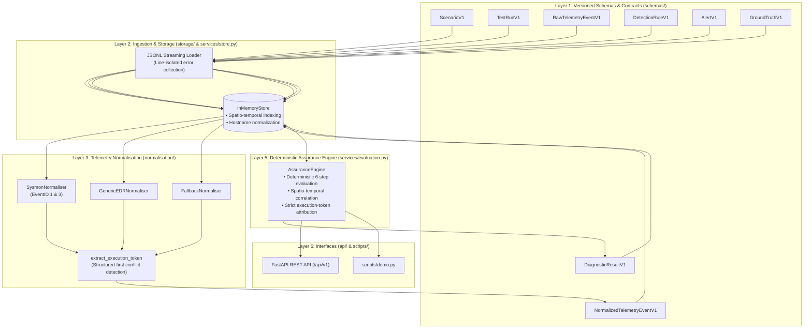
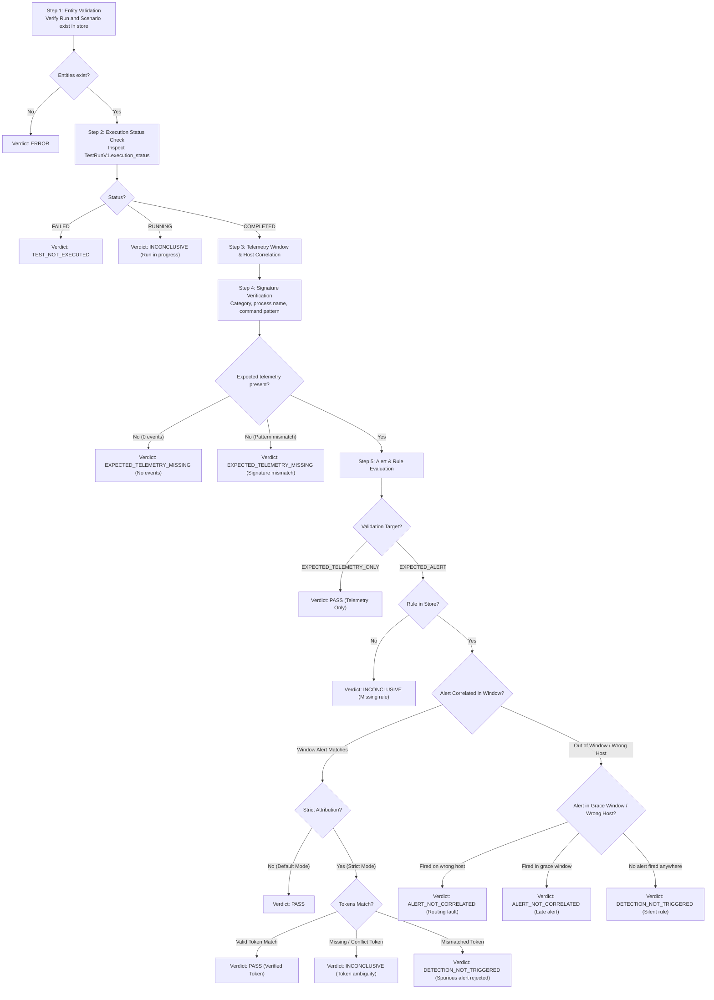
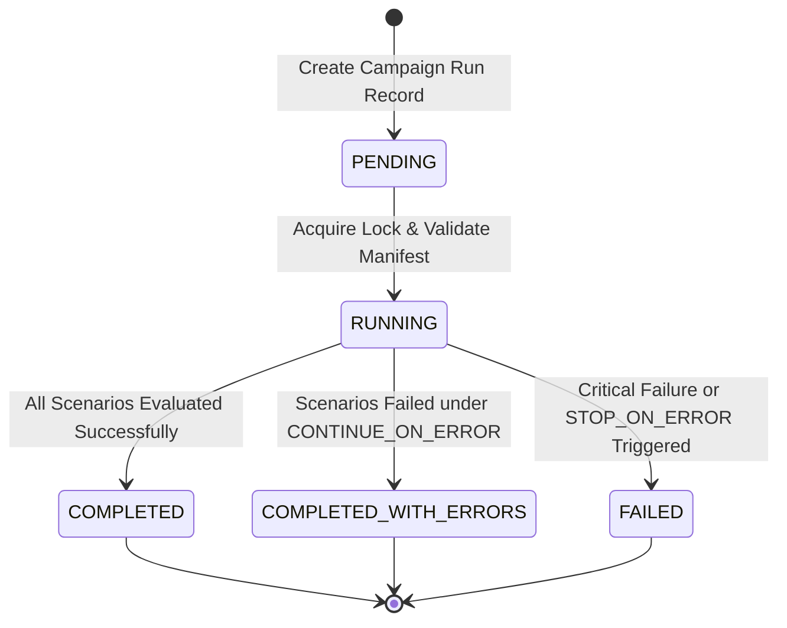

# PROOFSHIELD Architecture & Specification

## System Overview

**PROOFSHIELD** is an open, local-first, deterministic cybersecurity detection assurance and failure-diagnosis platform. It provides automated, reproducible verification of detection engineering pipelines, isolates root-cause telemetry and alerting gaps (e.g., sensor blackouts, pipeline latency, alert routing misattribution, and rule logic silence), and provides evidence-backed assurance metrics.

- **Author & Maintainer**: FS ([@00ppa](https://github.com/00ppa))
- **Current Version**: `0.1.0`
- **Core Technology**: Python 3.12, FastAPI, Pydantic v2, pytest
- **Evaluation Engine**: Architecture Layer 5 Deterministic Assurance Engine

---

## Architectural Principles & Invariants

1. **Local-First & Zero Paid Dependencies**:
   Runs completely locally without requiring cloud APIs, telemetry subscriptions, or proprietary external platforms.
2. **Strict Evidence Segregation**:
   Raw telemetry records, normalized events, scenario ground-truth definitions, detection rules, alerts, and diagnostic outcomes remain decoupled across independent data models.
3. **Independent Ground Truth**:
   Ground-truth labels are authored with test scenarios and are **never** mutated, overwritten, or influenced by diagnostic engine outputs.
4. **Deterministic Evaluation**:
   Diagnostic evaluation uses explicit rule-based determinism against indexed evidence. Ambiguous, contradictory, or insufficient evidence produces an `INCONCLUSIVE` verdict rather than unsupported heuristics or probabilistic guessing.
5. **Preservation Guarantees**:
   The telemetry normalisation layer guarantees that original source identifiers (`source_event_id`, `raw_event_id`) and timestamps (`source_timestamp`) are preserved intact without loss or truncation.
6. **Provenance & Execution Safety**:
   All test runs explicitly declare execution provenance (`execution_mode`, `is_synthetic`). No intrusive, payload-bearing, or shell commands are ever executed from imported telemetry.
7. **Seven Diagnostic Categories**:
   Outcomes map deterministically to one of seven formal categories:
   - `PASS`: Expected telemetry observed, detection rule fired, and alert correlated to testing window.
   - `TEST_NOT_EXECUTED`: Test execution failed or errored before producing intended activity.
   - `EXPECTED_TELEMETRY_MISSING`: Telemetry not observed within window or did not match expected signature.
   - `DETECTION_NOT_TRIGGERED`: Telemetry present, but expected detection rule did not fire in the monitoring system.
   - `ALERT_NOT_CORRELATED`: Alert exists from expected rule but cannot be linked to test run (host or window mismatch).
   - `INCONCLUSIVE`: Telemetry present but ambiguous, contradictory, or lacks rule definition for verdict.
   - `ERROR`: Evaluation could not proceed due to missing entity or configuration error.

---

## Architecture Layers & Data Flow

### Layer Descriptions

#### Layer 1: Versioned Data Schemas (`src/proofshield/schemas/`)
Implements Pydantic v2 schemas enforcing strict validation:
- **`ScenarioV1`**: Defines adversary behavior under test (MITRE ATT&CK technique and tactic), expected event category, expected process name/command pattern regex, multidimensional signature criteria (`expected_destination_ip`, `expected_destination_port`, `expected_file_path`, `expected_file_hash`, `expected_user`), `has_discriminating_signature()` guard, target detection rule ID, acceptable latency, and validation target (`EXPECTED_ALERT`, `EXPECTED_TELEMETRY_ONLY`, `EXPECTED_BENIGN`).
- **`TestRunV1`**: Execution record defining target endpoint/user, time window (`window_start`, `window_end`), execution status, optional `execution_token`, and execution provenance (`is_synthetic`).
- **`RawTelemetryEventV1`**: Immutable evidence container preserving the original payload dictionary, `source_event_id`, `source_timestamp`, and `ingested_at`.
- **`NormalizedTelemetryEventV1`**: Canonical schema (`PROCESS_CREATION`, `NETWORK_CONNECTION`, `FILE_EVENT`, `AUTHENTICATION`, etc.) with mapped process, hash, and network fields while strictly maintaining references to `raw_event_id`, preserved `source_event_id`, original `source_timestamp`, and extracted `execution_token`.
- **`DetectionRuleV1`**: Versioned detection rule record tracking rule formats (Sigma, Wazuh, Splunk), content hashes, and target evaluation backends.
- **`AlertV1`**: Security monitoring alert record correlated to test runs by host (supporting NetBIOS and FQDN) and temporal window.
- **`DiagnosticResultV1`**: Deterministic verdict classifying outcomes into one of the 7 diagnostic categories, with `confidence` level, detailed `diagnostic_reasons`, explicit lists of `supporting_evidence_ids` and `contradictory_evidence_ids`, and attribution metadata.
- **`GroundTruthV1`**: Independently authored expectation records for measuring diagnostic classification accuracy against controlled attack executions or fault injections.

#### Layer 2: Ingestion & Storage (`src/proofshield/storage/`, `src/proofshield/services/`)
- **Streaming JSONL Loader**: Line-isolated parsing (`validate_jsonl_stream`, `validate_jsonl_file`) recording line numbers on parsed records and isolating syntax/schema failures without aborting the stream.
- **`StoreProtocol`**: Formal storage contract implemented by both backends, defining synchronous entity CRUD, time-window and host correlation queries, and atomic `transaction()` context management.
- **`InMemoryStore`**: Fast in-memory entity store providing time-window event correlation, host matching (`hosts_match`) supporting case-insensitivity, FQDN suffix normalization, and snapshot-rollback transaction isolation.
- **`SQLiteStore`**: Enterprise local persistence using WAL journal mode, explicit foreign key enforcement, multi-column indexes (`EXPLAIN QUERY PLAN` verified), and re-entrant savepoint transactions.

#### Layer 3: Telemetry Normalisation (`src/proofshield/normalisation/`)
- **Plugin Normalisation Engine**: Dispatches raw events to registered normalisers (`SysmonNormaliser`, `GenericEDRNormaliser`, `AuditdNormaliser`, `FallbackNormaliser`).
- **Attribute Preservation**: Enforces zero loss of raw identifiers and original timestamps.
- **Token Extraction**: `extract_execution_token` inspects structured payload fields first, then searches unstructured command lines and text fields using regex patterns. If conflicting candidate tokens are detected, the token is permanently flagged as `CONFLICT` to prevent false attribution.

#### Layer 4: Detection & Alert Ingestion
Alerts ingested into `InMemoryStore` are normalized with host matching and timestamp boundaries. If an alert arrives without an event timestamp, `ingested_at` is preserved and flagged with `ingestion_time_only=True` to prevent false latency inferences.

#### Layer 5: Deterministic Assurance Engine (`src/proofshield/services/evaluation.py`)
The core diagnostic reasoning component. Implements a deterministic 6-step evaluation pipeline:

#### Layer 6: Interfaces (`src/proofshield/api/`, `scripts/`)
- **FastAPI Endpoints**:
  - `GET /health`, `GET /api/v1/health`: System health and schema catalogue.
  - `POST /api/v1/telemetry/raw`: Ingest raw telemetry records with opt-in persistence (`?store=true`).
  - `POST /api/v1/telemetry/normalize`: Ingest and normalise raw events with opt-in persistence (`?store=true`).
  - `POST /api/v1/ingest/jsonl`: Streaming JSONL dataset validation and ingestion (`store: bool`, `atomic: bool`).
  - `POST /api/v1/evaluation/{run_id}`: Trigger deterministic diagnostic evaluation (supports `?strict_attribution=true`).
- **Interactive Terminal Demo**: `scripts/demo.py` provides standalone verification of nominal passes and failure modes in < 3ms.

---

## Dual-Mode Attribution & Causal Confounding Resolution

### The Spatio-Temporal Confounding Problem (BM-25)
Standard detection validation tools correlate alerts solely using **spatial matching** (host IP or hostname) and **temporal windowing** (test start/end time). In shared or active enterprise environments, an unrelated background job (e.g., an administrative script or benign user activity) may trigger the target detection rule on the same host during the test window.

Under spatio-temporal correlation:
- The evaluator observes the alert within the window on the target host.
- It falsely assumes the tested attack caused the alert.
- It reports a **false PASS** (False Discovery Rate = 5.0% on the 25-scenario benchmark).

### Strict Execution-Token Attribution
PROOFSHIELD introduces execution-token attribution:
1. An ephemeral execution token (e.g., `TOK-ATK-01`) is bound to the test run, embedded in the attack payload/command-line, and propagated through telemetry to the alert.
2. In **Default Mode** (`strict_attribution=False`), spatio-temporal correlation is maintained for backward compatibility.
3. In **Strict Mode** (`strict_attribution=True`):
   - Mismatched tokens are rejected without assuming detection failure.
   - Alerts arriving within the post-execution grace period are never permitted to produce a `PASS`.
   - Missing or conflicting evidence yields `INCONCLUSIVE`.
   - On Benchmark BM-25, the spurious background alert (bearing token `TOK-BG-02`) is rejected, accurately exposing that the detection rule failed to fire for the tested attack (`DETECTION_NOT_TRIGGERED`), reducing FDR to **0.0%**.

---

## Benchmark Metrics & Formal Mathematical Definitions

Evaluated across the 25 controlled benchmark scenarios (BM-01 to BM-25) against independently assigned `GroundTruthV1` labels:

### 1. Diagnostic Accuracy
The proportion of all evaluated test runs where the predicted diagnostic category exactly matches the independently verified ground-truth category:
$$\text{Accuracy} = \frac{\sum_{i=1}^N \mathbb{I}(y_i^{\text{true}} = y_i^{\text{pred}})}{N}$$

### 2. False-Diagnosis Rate (FDR)
The proportion of confident diagnostic predictions (excluding `INCONCLUSIVE`) that disagree with ground truth:
$$\text{FDR} = \frac{\sum_{i=1}^N \mathbb{I}(y_i^{\text{pred}} \neq \text{INCONCLUSIVE} \land y_i^{\text{true}} \neq y_i^{\text{pred}})}{\sum_{i=1}^N \mathbb{I}(y_i^{\text{pred}} \neq \text{INCONCLUSIVE})}$$

### 3. Inconclusive Rate (IR)
The proportion of all evaluated test runs classified as `INCONCLUSIVE` due to ambiguous, missing, or contradictory evidence:
$$\text{IR} = \frac{\sum_{i=1}^N \mathbb{I}(y_i^{\text{pred}} = \text{INCONCLUSIVE})}{N}$$

### 4. Evidence-Support Completeness (ESC)
The proportion of all evaluated test runs whose diagnostic verdict is backed by strictly validated evidence records existing in the store:
$$\text{ESC} = \frac{\sum_{i=1}^N \mathbb{I}(\text{EvidenceValid}_i)}{N}$$

---

## Layer 7: Detection Validation Campaign Engine (Phase 16)

Phase 16 extends PROOFSHIELD from single-run ad-hoc evaluation to automated, deterministic **Detection Validation Campaigns**, auditable evidence manifests, replay verification, and regression comparisons.

### 1. Campaign Domain Architecture

The campaign domain model resides in `src/proofshield/schemas/campaign.py`:

- **`CampaignDefinitionV1`**: Declares a collection of validation scenarios to test, execution configuration (`ExecutionConfigV1`), tags, and metadata. Enforces identifier regexes, disallows executable script injections, and prevents empty scenario sets.
- **`CampaignRunV1`**: Record of an executed campaign instance tracking lifecycle status (`PENDING`, `RUNNING`, `COMPLETED`, `COMPLETED_WITH_ERRORS`, `FAILED`), scenario counts, per-scenario results (`ScenarioCampaignResultV1`), aggregated root-cause groups (`RootCauseGroupV1`), summary metrics (`CampaignSummaryV1`), evidence manifests (`EvidenceManifestV1`), and replay linkage (`source_run_id`, `is_replay`).
- **`EvidenceManifestV1`**: Cryptographically verifiable manifest referencing all input scenarios, test runs, normalized telemetry IDs, alert IDs, and ground-truth IDs, secured with a canonical SHA-256 hash.
- **`CampaignComparisonV1`**: Deterministic diff between two campaign runs isolating regressions, improvements, newly inconclusive scenarios, added/removed scenarios, manifest divergences, and metric deltas.

### 2. Campaign Lifecycle & Execution Engine

Implemented in `src/proofshield/services/campaign_engine.py`:

#### Execution Policies
1. **`CONTINUE_ON_ERROR`** (Default): If an unhandled exception or critical error occurs during a scenario evaluation, that scenario is recorded with status `ERROR`, and execution proceeds to the next scenario. The run concludes with status `COMPLETED_WITH_ERRORS`.
2. **`STOP_ON_ERROR`**: If any scenario encounters an evaluation error, execution halts immediately. Remaining scenarios are marked `SKIPPED`, and the run concludes with status `FAILED`.

### 3. Evidence Integrity & Canonicalization

Implemented in `src/proofshield/services/canonical.py`:
- **RFC 8785 Canonical JSON (JCS)**: Full conformance with RFC 8785 / ECMAScript 7.1.12.1 in pure Python without extra dependencies. Implements ECMAScript float-to-string conversion (e.g. `1.0` -> `1`, `-0.0` -> `0`, `1e20` -> `100000000000000000000`), UTF-16 code-unit property sorting (e.g. astral characters like `\U0001D11E` sorted before `\uFFFF`), character escaping, and strict rejection of NaN and Infinity. Cross-validated against Node.js reference engine.
- **Canonical SHA-256**: Generates SHA-256 digests over canonical UTF-8 bytes of scenarios, test runs, normalized telemetry events, alerts, ground truth records, and execution configuration.
- **Evidence Content Binding**: In `src/proofshield/schemas/campaign.py`, `ScenarioEvidenceRefV1` and `EvidenceManifestV1` bind the full cryptographic SHA-256 content hashes of every normalized event (`telemetry_event_hashes`), alert (`alert_hashes`), ground truth (`ground_truth_hash`), and configuration (`execution_config_hash`).
- **Integrity Scope & Threat Model**:
  - *Implemented Detection*: Hash verification compares evidence payload digests against stored manifest hashes during replay. This detects accidental corruption, record drift, or substitution of evidence records relative to a known digest.
  - *Adversarial Boundary*: SHA-256 hashing alone does not prevent deliberate tampering if an attacker has write access to both the evidence store and the stored manifest digest, as the attacker can recompute matching hashes over manipulated evidence.
  - *Future Hardening*: Stronger tamper evidence requires independently protected reference digests, such as access-controlled append-only storage, an out-of-band audit logging system, or digital signatures backed by a protected private signing key.
  - *Authenticity vs Truthfulness*: A digital signature or cryptographic hash proves only that a particular payload or private key signed/produced the data; it does not by itself prove that the original endpoint telemetry was truthful, unevaded, or faithfully captured by the sensor at operating system level.

### 4. Replay Engine & Replay Classifications

The replay engine (`CampaignEngine.replay_campaign_run`) re-evaluates a historical campaign against previously captured, immutable evidence:
- **Historical Immutability**: The original `CampaignRunV1` is never modified or overwritten. Replay creates an independent run with `is_replay=True` and `source_run_id` set to the original run ID.
- **Manifest Internal Hash Verification**: Reconstructs the canonical manifest hash from its components; if the stored manifest has been tampered with or is inconsistent, flags `manifest_valid=False`.
- **Deep Content Verification**: Compares the SHA-256 content hashes of every scenario, test run, telemetry event, alert, and ground truth record currently in storage against the recorded hashes in the manifest.
- **Explicit Replay Classifications**:
  1. `EXACT_REPLAY`: Manifest is valid, zero missing or altered evidence, matching engine version, matching execution configuration, and identical diagnostic outcomes.
  2. `EVIDENCE_REEVALUATION`: Evidence or scenario definitions were modified, replaced, or deleted in storage.
  3. `ENGINE_COMPARISON`: Evidence is identical, but evaluated under a different engine version or execution configuration.
  4. `INVALID_MANIFEST`: The evidence manifest failed internal cryptographic hash verification.
- **No Active Execution**: Replay operates strictly in memory/database against historical evidence; it never contacts external endpoints or executes offensive payloads.

### 5. Metric Aggregation & Explicit Denominators

All campaign-level metrics in `CampaignSummaryV1` define explicit mathematical denominators:
- **`pass_rate`**: $\frac{\text{Passed Scenarios}}{\text{Executed Scenarios}}$ (excludes `TEST_NOT_EXECUTED` and `SKIPPED`; reported as `None` if executed scenarios = 0).
- **`execution_coverage`**: $\frac{\text{Executed Scenarios}}{\text{Total Scenarios}}$
- **`inconclusive_rate`**: $\frac{\text{Inconclusive Scenarios}}{\text{Executed Scenarios}}$
- **`error_rate`**: $\frac{\text{Error Scenarios}}{\text{Total Scenarios}}$
- **`evidence_completeness`**: $\frac{\text{Complete Evidence Scenarios}}{\text{Executed Scenarios}}$
- **`precision`, `recall`, `f1`**: Computed exclusively when valid ground truth is available; reported as `None` if ground truth is absent.

### 6. Storage Parity & Isolation Semantics

Campaign definitions and runs are fully integrated into `StoreProtocol` with complete parity across `InMemoryStore` and `SQLiteStore`:
- **`InMemoryStore`**: Thread-safe operations protected by re-entrant locks (`threading.RLock`) and snapshot rollbacks during transactions.
- **`SQLiteStore`**: Relational tables (`campaigns`, `campaign_runs`) using foreign key constraints, indexes on `campaign_id` and `started_at`, and WAL mode transactions.

### 7. Campaign Assurance Intelligence & Regression Analysis (Phase 17)

Phase 17 elevates campaign execution records into an auditable intelligence and regression analysis layer:

#### A. Campaign Assurance Report Lifecycle (`CampaignAssuranceReportV1`)
- **Non-Destructive Aggregation**: Compiles reports directly from historical execution records (`CampaignRunV1`) and stored evidence without re-executing payloads or modifying underlying database rows.
- **Explicit Detection Assurance Metrics**:
  - `detection_success_rate`: $\frac{\text{successful\_executions}}{\text{executed\_test\_cases}}$ (excludes unexecuted scenarios; `INSUFFICIENT_DATA` if denominator is 0).
  - `detection_failure_rate`: $\frac{\text{failed\_executions}}{\text{executed\_test\_cases}}$
  - `telemetry_availability_rate`: $\frac{\text{executed\_test\_cases} - \text{expected\_telemetry\_missing\_count}}{\text{executed\_test\_cases}}$
  - `evidence_completeness_rate`: $\frac{\text{executed\_test\_cases} - \text{missing\_evidence\_count}}{\text{executed\_test\_cases}}$
  - `alert_correlation_rate`: $\frac{\text{correlated\_alert\_scenarios}}{\text{correlated\_alert\_scenarios} + \text{alert\_not\_correlated\_scenarios}}$
  - `inconclusive_rate`: $\frac{\text{inconclusive\_executions}}{\text{executed\_test\_cases}}$
  - `execution_coverage`: $\frac{\text{executed\_test\_cases}}{\text{total\_declared\_scenarios}}$
- **Diagnostic Distribution**: Exact count and percentage breakdowns across the 7 canonical categories (`PASS`, `TEST_NOT_EXECUTED`, `EXPECTED_TELEMETRY_MISSING`, `DETECTION_NOT_TRIGGERED`, `ALERT_NOT_CORRELATED`, `INCONCLUSIVE`, `ERROR`).
- **Cryptographic Quality Audit**: Verifies stored evidence against manifest hashes; flags `VERIFIED`, `INTEGRITY_COMPROMISED`, `MISSING_EVIDENCE`, `MANIFEST_ABSENT`, or `UNVERIFIED`.
- **RFC 8785 Canonical Digest**: Every report is sealed with an SHA-256 digest over its deterministic canonical representation. On retrieval, `CampaignAssuranceReportGenerator.verify_report_integrity` verifies bit-for-bit authenticity, detecting tampering or silent data corruption.

#### B. Regression Intelligence (`CampaignRegressionAnalyzer`)
- **Compatibility Audit**: Evaluates comparability between baseline and candidate runs before generating comparative claims. Identifies:
  - Disjoint scenario suites (flags verdict `INCOMPARABLE`).
  - Zero executed test cases in baseline or candidate (flags verdict `INSUFFICIENT_DATA`).
  - Configuration drift (e.g. grace period changes) and engine version drift.
- **Finding Generation**: Emits deterministic `RegressionFindingV1` records with explicit severities (`CRITICAL`, `HIGH`, `MEDIUM`, `LOW`, `INFORMATIONAL`) and `is_actionable` flags:
  - `DETECTION_REGRESSION`: Scenario regressed from PASS to Failure/Error (`CRITICAL` or `HIGH`, actionable).
  - `DETECTION_IMPROVEMENT`: Previously failing scenario now passes (`INFORMATIONAL`, non-actionable).
  - `METRIC_DETERIORATION`: Any metric degradation $\le -0.0001$ (`HIGH` or `MEDIUM`, actionable).
  - `METRIC_IMPROVEMENT`: Metric increase $\ge 0.0001$ (`INFORMATIONAL`).
  - `TELEMETRY_GAP_INCREASE`, `ALERT_CORRELATION_DETERIORATION`, `INCONCLUSIVE_RATE_INCREASE`, `EVIDENCE_COMPLETENESS_DETERIORATION`.
- **Verdict Determinism**: Resolves to `REGRESSION`, `IMPROVEMENT`, `NO_CHANGE`, `INSUFFICIENT_DATA`, or `INCOMPARABLE`.

#### C. Root-Cause Intelligence (`RootCauseIntelligenceService`)
- Aggregates diagnostic failures across scenarios into structured `RootCausePatternV1` groups.
- Strictly bifurcates empirically **observed facts** from plausible **inferred explanations**.
- Tracks supporting evidence IDs for independent analyst auditability.

#### D. Storage & REST API
- **Storage Parity**: New entity `campaign_assurance_reports` implemented across `InMemoryStore` and `SQLiteStore` (with foreign keys to `campaigns` and `campaign_runs`, transaction rollback safety, and indexes).
- **Versioned Endpoints**:
  - `POST /api/v1/campaign-runs/{run_id}/assurance-report`: Compiles and stores an assurance report.
  - `GET /api/v1/campaign-assurance-reports/{report_id}`: Retrieves an assurance report and validates its canonical content digest.
  - `GET /api/v1/campaign-assurance-reports`: Lists reports with bounded pagination.
  - `POST /api/v1/campaign-runs/{run_id}/regression-analysis`: Executes regression analysis against a baseline run.
  - `GET /api/v1/campaign-runs/{run_id}/regression/{base_run_id}`: Comparative regression shortcut.
  - `GET /api/v1/campaign-runs/{run_id}/root-cause-intelligence`: Aggregated diagnostic patterns and root-cause intelligence.

---

## Research Validity, Synthetic Benchmarks & Explicit Non-Claims

### Synthetic Benchmark Scope
All benchmark suites (`tests/test_benchmark.py` BM-01 to BM-25 and `tests/test_fault_matrix.py` FT-01 to FT-12) are **controlled synthetic experiments**. They are designed to empirically verify:
- Deterministic decision-path coverage across all 7 diagnostic categories.
- Boundary conditions (exact timestamps, grace periods, missing fields).
- Algorithmic resolution of concurrent alert confounding.

### Explicit Research Non-Claims
1. **No Live SOC Adoption Claim**: PROOFSHIELD has been developed and evaluated locally against synthetic and emulated datasets. It does not currently claim deployment or validation across active production commercial Security Operations Centers (SOCs).
2. **Provenance vs. Cryptographic Proof**: Execution-token attribution provides strong execution provenance and correlation safeguards. It does **not** claim cryptographic non-repudiation or formal philosophical causality (e.g., in the Pearl/counterfactual sense).
3. **Pluggable Storage Boundary**: PROOFSHIELD provides dual first-class storage backends: fast `InMemoryStore` for ephemeral unit testing and production-grade local `SQLiteStore` (with WAL mode, foreign keys, and indexes) for persistent multi-run workflows. Distributed cloud storage (e.g., PostgreSQL or CockroachDB) represents future enterprise clustering.
