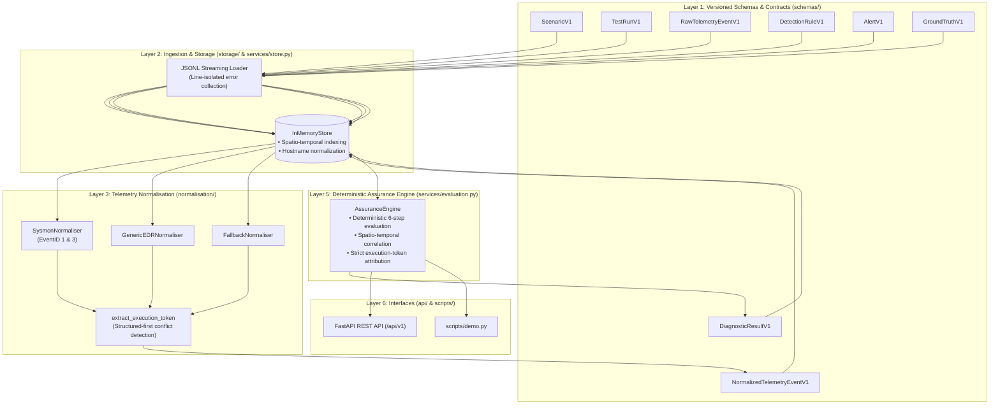
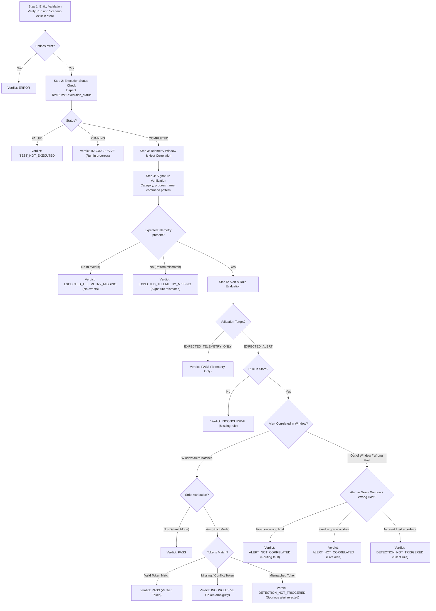

# PROOFSHIELD Architecture & Specification

## System Overview

**PROOFSHIELD** is an open, local-first, deterministic cybersecurity detection assurance and failure-diagnosis platform. It provides automated, reproducible verification of detection engineering pipelines, isolates root-cause telemetry and alerting gaps (e.g., sensor blackouts, pipeline latency, alert routing misattribution, and rule logic silence), and provides evidence-backed assurance metrics.

- **Author & Maintainer**: FS ([@00ppa](https://github.com/00ppa))
- **Current Version**: `0.1.0`
- **Core Technology**: Python 3.12, FastAPI, Pydantic v2, pytest
- **Evaluation Engine**: Architecture Layer 5 Deterministic Assurance Engine

---

## Architectural Principles & Invariants

1. **Local-First & Zero Paid Dependencies**:
   Runs completely locally without requiring cloud APIs, telemetry subscriptions, or proprietary external platforms.
2. **Strict Evidence Segregation**:
   Raw telemetry records, normalized events, scenario ground-truth definitions, detection rules, alerts, and diagnostic outcomes remain decoupled across independent data models.
3. **Independent Ground Truth**:
   Ground-truth labels are authored with test scenarios and are **never** mutated, overwritten, or influenced by diagnostic engine outputs.
4. **Deterministic Evaluation**:
   Diagnostic evaluation uses explicit rule-based determinism against indexed evidence. Ambiguous, contradictory, or insufficient evidence produces an `INCONCLUSIVE` verdict rather than unsupported heuristics or probabilistic guessing.
5. **Preservation Guarantees**:
   The telemetry normalisation layer guarantees that original source identifiers (`source_event_id`, `raw_event_id`) and timestamps (`source_timestamp`) are preserved intact without loss or truncation.
6. **Provenance & Execution Safety**:
   All test runs explicitly declare execution provenance (`execution_mode`, `is_synthetic`). No intrusive, payload-bearing, or shell commands are ever executed from imported telemetry.
7. **Seven Diagnostic Categories**:
   Outcomes map deterministically to one of seven formal categories:
   - `PASS`: Expected telemetry observed, detection rule fired, and alert correlated to testing window.
   - `TEST_NOT_EXECUTED`: Test execution failed or errored before producing intended activity.
   - `EXPECTED_TELEMETRY_MISSING`: Telemetry not observed within window or did not match expected signature.
   - `DETECTION_NOT_TRIGGERED`: Telemetry present, but expected detection rule did not fire in the monitoring system.
   - `ALERT_NOT_CORRELATED`: Alert exists from expected rule but cannot be linked to test run (host or window mismatch).
   - `INCONCLUSIVE`: Telemetry present but ambiguous, contradictory, or lacks rule definition for verdict.
   - `ERROR`: Evaluation could not proceed due to missing entity or configuration error.

---

## Architecture Layers & Data Flow

### Layer Descriptions

#### Layer 1: Versioned Data Schemas (`src/proofshield/schemas/`)
Implements Pydantic v2 schemas enforcing strict validation:
- **`ScenarioV1`**: Defines adversary behavior under test (MITRE ATT&CK technique and tactic), expected event category, expected process name/command pattern regex, multidimensional signature criteria (`expected_destination_ip`, `expected_destination_port`, `expected_file_path`, `expected_file_hash`, `expected_user`), `has_discriminating_signature()` guard, target detection rule ID, acceptable latency, and validation target (`EXPECTED_ALERT`, `EXPECTED_TELEMETRY_ONLY`, `EXPECTED_BENIGN`).
- **`TestRunV1`**: Execution record defining target endpoint/user, time window (`window_start`, `window_end`), execution status, optional `execution_token`, and execution provenance (`is_synthetic`).
- **`RawTelemetryEventV1`**: Immutable evidence container preserving the original payload dictionary, `source_event_id`, `source_timestamp`, and `ingested_at`.
- **`NormalizedTelemetryEventV1`**: Canonical schema (`PROCESS_CREATION`, `NETWORK_CONNECTION`, `FILE_EVENT`, `AUTHENTICATION`, etc.) with mapped process, hash, and network fields while strictly maintaining references to `raw_event_id`, preserved `source_event_id`, original `source_timestamp`, and extracted `execution_token`.
- **`DetectionRuleV1`**: Versioned detection rule record tracking rule formats (Sigma, Wazuh, Splunk), content hashes, and target evaluation backends.
- **`AlertV1`**: Security monitoring alert record correlated to test runs by host (supporting NetBIOS and FQDN) and temporal window.
- **`DiagnosticResultV1`**: Deterministic verdict classifying outcomes into one of the 7 diagnostic categories, with `confidence` level, detailed `diagnostic_reasons`, explicit lists of `supporting_evidence_ids` and `contradictory_evidence_ids`, and attribution metadata.
- **`GroundTruthV1`**: Independently authored expectation records for measuring diagnostic classification accuracy against controlled attack executions or fault injections.

#### Layer 2: Ingestion & Storage (`src/proofshield/storage/`, `src/proofshield/services/`)
- **Streaming JSONL Loader**: Line-isolated parsing (`validate_jsonl_stream`, `validate_jsonl_file`) recording line numbers on parsed records and isolating syntax/schema failures without aborting the stream.
- **`StoreProtocol`**: Formal storage contract implemented by both backends, defining synchronous entity CRUD, time-window and host correlation queries, and atomic `transaction()` context management.
- **`InMemoryStore`**: Fast in-memory entity store providing time-window event correlation, host matching (`hosts_match`) supporting case-insensitivity, FQDN suffix normalization, and snapshot-rollback transaction isolation.
- **`SQLiteStore`**: Enterprise local persistence using WAL journal mode, explicit foreign key enforcement, multi-column indexes (`EXPLAIN QUERY PLAN` verified), and re-entrant savepoint transactions.

#### Layer 3: Telemetry Normalisation (`src/proofshield/normalisation/`)
- **Plugin Normalisation Engine**: Dispatches raw events to registered normalisers (`SysmonNormaliser`, `GenericEDRNormaliser`, `AuditdNormaliser`, `FallbackNormaliser`).
- **Attribute Preservation**: Enforces zero loss of raw identifiers and original timestamps.
- **Token Extraction**: `extract_execution_token` inspects structured payload fields first, then searches unstructured command lines and text fields using regex patterns. If conflicting candidate tokens are detected, the token is permanently flagged as `CONFLICT` to prevent false attribution.

#### Layer 4: Detection & Alert Ingestion
Alerts ingested into `InMemoryStore` are normalized with host matching and timestamp boundaries. If an alert arrives without an event timestamp, `ingested_at` is preserved and flagged with `ingestion_time_only=True` to prevent false latency inferences.

#### Layer 5: Deterministic Assurance Engine (`src/proofshield/services/evaluation.py`)
The core diagnostic reasoning component. Implements a deterministic 6-step evaluation pipeline:

#### Layer 6: Interfaces (`src/proofshield/api/`, `scripts/`)
- **FastAPI Endpoints**:
  - `GET /health`, `GET /api/v1/health`: System health and schema catalogue.
  - `POST /api/v1/telemetry/raw`: Ingest raw telemetry records with opt-in persistence (`?store=true`).
  - `POST /api/v1/telemetry/normalize`: Ingest and normalise raw events with opt-in persistence (`?store=true`).
  - `POST /api/v1/ingest/jsonl`: Streaming JSONL dataset validation and ingestion (`store: bool`, `atomic: bool`).
  - `POST /api/v1/evaluation/{run_id}`: Trigger deterministic diagnostic evaluation (supports `?strict_attribution=true`).
- **Interactive Terminal Demo**: `scripts/demo.py` provides standalone verification of nominal passes and failure modes in < 3ms.

---

## Dual-Mode Attribution & Causal Confounding Resolution

### The Spatio-Temporal Confounding Problem (BM-25)
Standard detection validation tools correlate alerts solely using **spatial matching** (host IP or hostname) and **temporal windowing** (test start/end time). In shared or active enterprise environments, an unrelated background job (e.g., an administrative script or benign user activity) may trigger the target detection rule on the same host during the test window.

Under spatio-temporal correlation:
- The evaluator observes the alert within the window on the target host.
- It falsely assumes the tested attack caused the alert.
- It reports a **false PASS** (False Discovery Rate = 5.0% on the 25-scenario benchmark).

### Strict Execution-Token Attribution
PROOFSHIELD introduces execution-token attribution:
1. An ephemeral execution token (e.g., `TOK-ATK-01`) is bound to the test run, embedded in the attack payload/command-line, and propagated through telemetry to the alert.
2. In **Default Mode** (`strict_attribution=False`), spatio-temporal correlation is maintained for backward compatibility.
3. In **Strict Mode** (`strict_attribution=True`):
   - Mismatched tokens are rejected without assuming detection failure.
   - Alerts arriving within the post-execution grace period are never permitted to produce a `PASS`.
   - Missing or conflicting evidence yields `INCONCLUSIVE`.
   - On Benchmark BM-25, the spurious background alert (bearing token `TOK-BG-02`) is rejected, accurately exposing that the detection rule failed to fire for the tested attack (`DETECTION_NOT_TRIGGERED`), reducing FDR to **0.0%**.

---

## Benchmark Metrics & Formal Mathematical Definitions

Evaluated across the 25 controlled benchmark scenarios (BM-01 to BM-25) against independently assigned `GroundTruthV1` labels:

### 1. Diagnostic Accuracy
The proportion of all evaluated test runs where the predicted diagnostic category exactly matches the independently verified ground-truth category:
$$\text{Accuracy} = \frac{\sum_{i=1}^N \mathbb{I}(y_i^{\text{true}} = y_i^{\text{pred}})}{N}$$

### 2. False-Diagnosis Rate (FDR)
The proportion of confident diagnostic predictions (excluding `INCONCLUSIVE`) that disagree with ground truth:
$$\text{FDR} = \frac{\sum_{i=1}^N \mathbb{I}(y_i^{\text{pred}} \neq \text{INCONCLUSIVE} \land y_i^{\text{true}} \neq y_i^{\text{pred}})}{\sum_{i=1}^N \mathbb{I}(y_i^{\text{pred}} \neq \text{INCONCLUSIVE})}$$

### 3. Inconclusive Rate (IR)
The proportion of all evaluated test runs classified as `INCONCLUSIVE` due to ambiguous, missing, or contradictory evidence:
$$\text{IR} = \frac{\sum_{i=1}^N \mathbb{I}(y_i^{\text{pred}} = \text{INCONCLUSIVE})}{N}$$

### 4. Evidence-Support Completeness (ESC)
The proportion of all evaluated test runs whose diagnostic verdict is backed by strictly validated evidence records existing in the store:
$$\text{ESC} = \frac{\sum_{i=1}^N \mathbb{I}(\text{EvidenceValid}_i)}{N}$$

---

## Research Validity, Synthetic Benchmarks & Explicit Non-Claims

### Synthetic Benchmark Scope
All benchmark suites (`tests/test_benchmark.py` BM-01 to BM-25 and `tests/test_fault_matrix.py` FT-01 to FT-12) are **controlled synthetic experiments**. They are designed to empirically verify:
- Deterministic decision-path coverage across all 7 diagnostic categories.
- Boundary conditions (exact timestamps, grace periods, missing fields).
- Algorithmic resolution of concurrent alert confounding.

### Explicit Research Non-Claims
1. **No Live SOC Adoption Claim**: PROOFSHIELD has been developed and evaluated locally against synthetic and emulated datasets. It does not currently claim deployment or validation across active production commercial Security Operations Centers (SOCs).
2. **Provenance vs. Cryptographic Proof**: Execution-token attribution provides strong execution provenance and correlation safeguards. It does **not** claim cryptographic non-repudiation or formal philosophical causality (e.g., in the Pearl/counterfactual sense).
3. **Pluggable Storage Boundary**: PROOFSHIELD provides dual first-class storage backends: fast `InMemoryStore` for ephemeral unit testing and production-grade local `SQLiteStore` (with WAL mode, foreign keys, and indexes) for persistent multi-run workflows. Distributed cloud storage (e.g., PostgreSQL or CockroachDB) represents future enterprise clustering.
