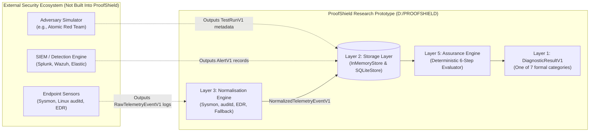
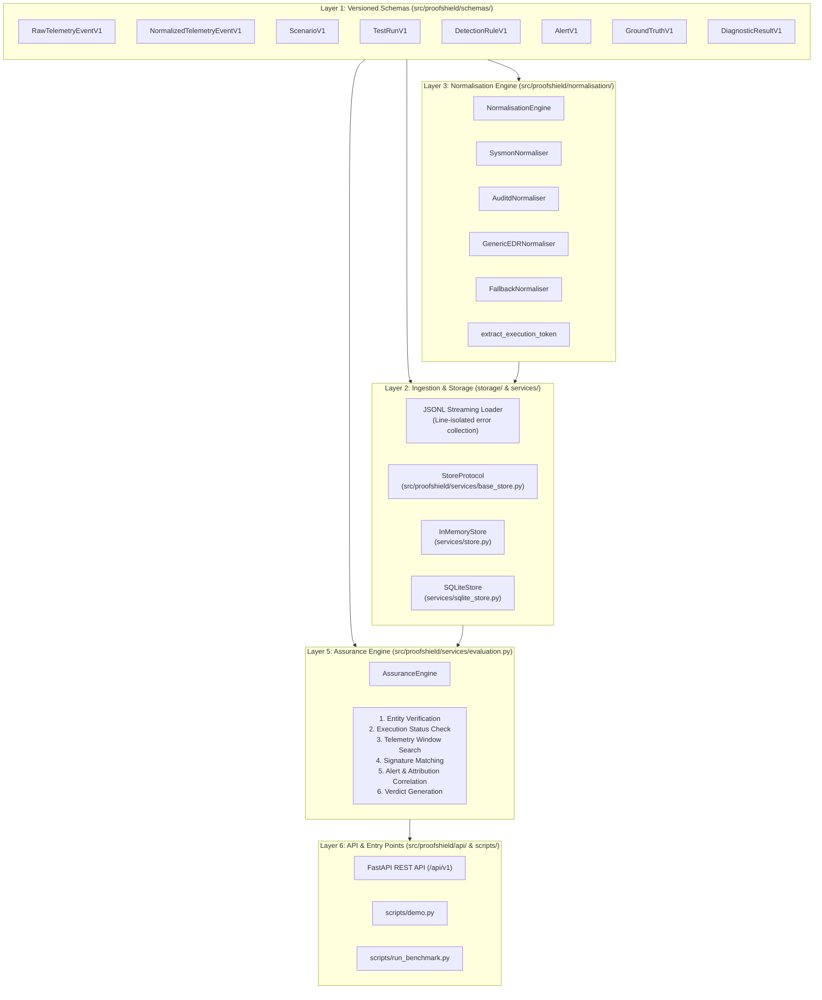
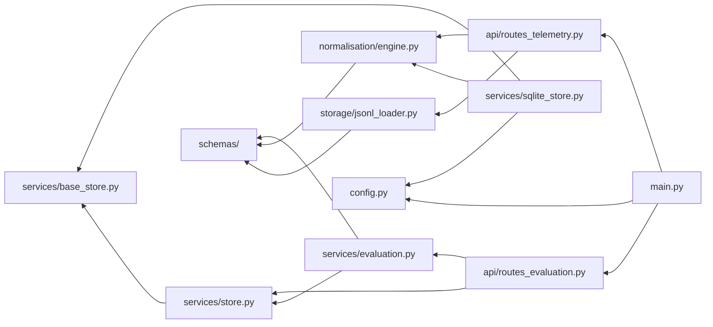
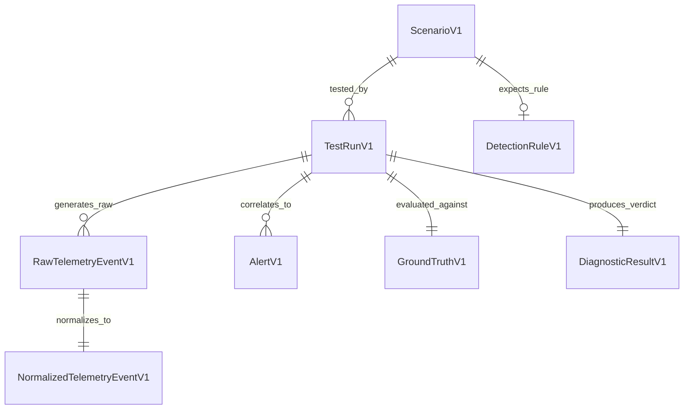
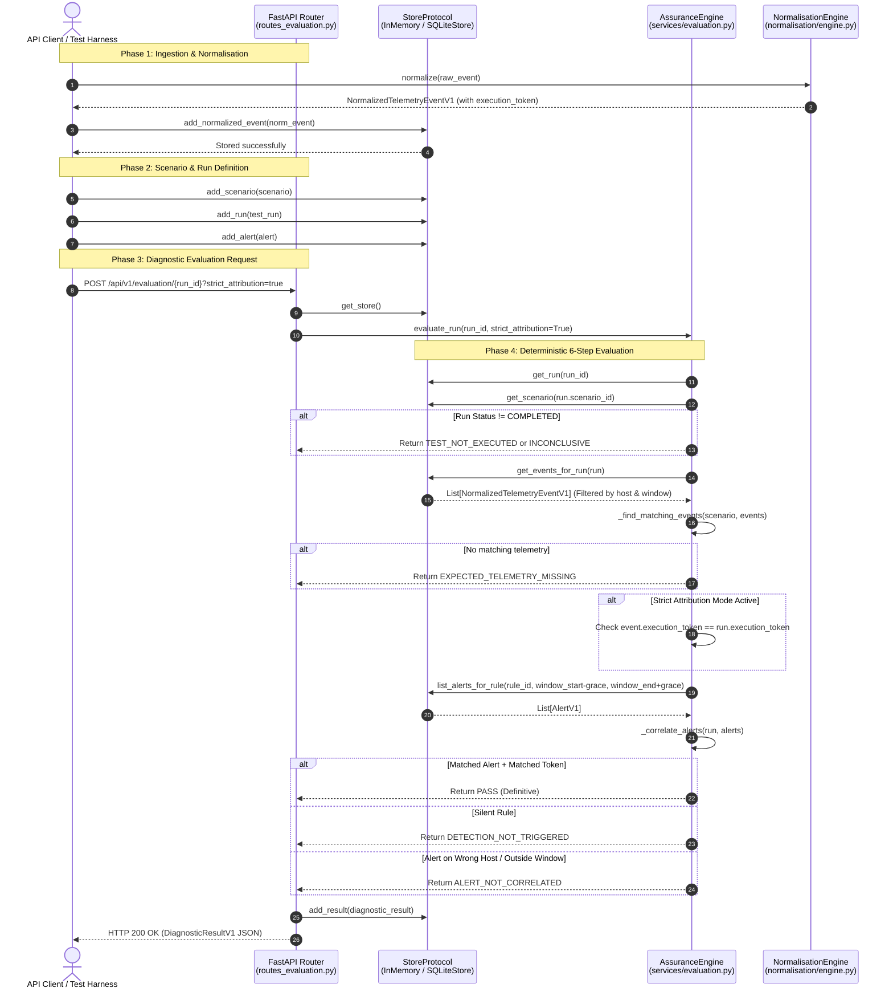
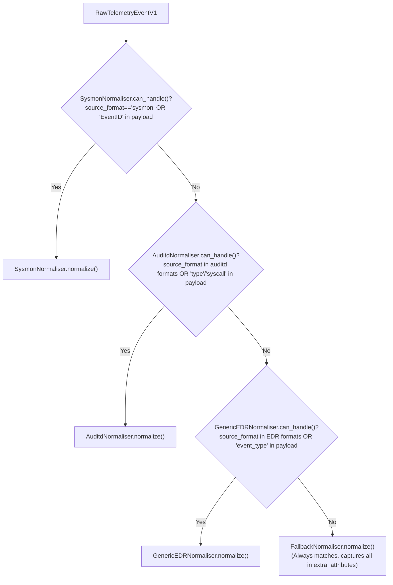
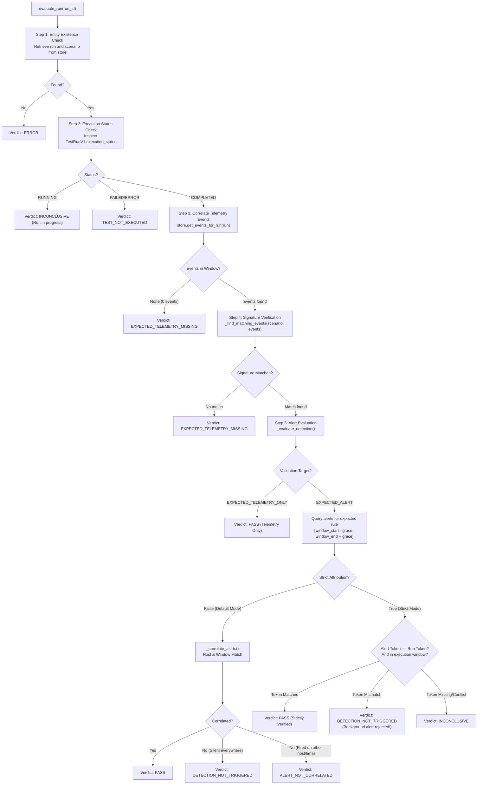
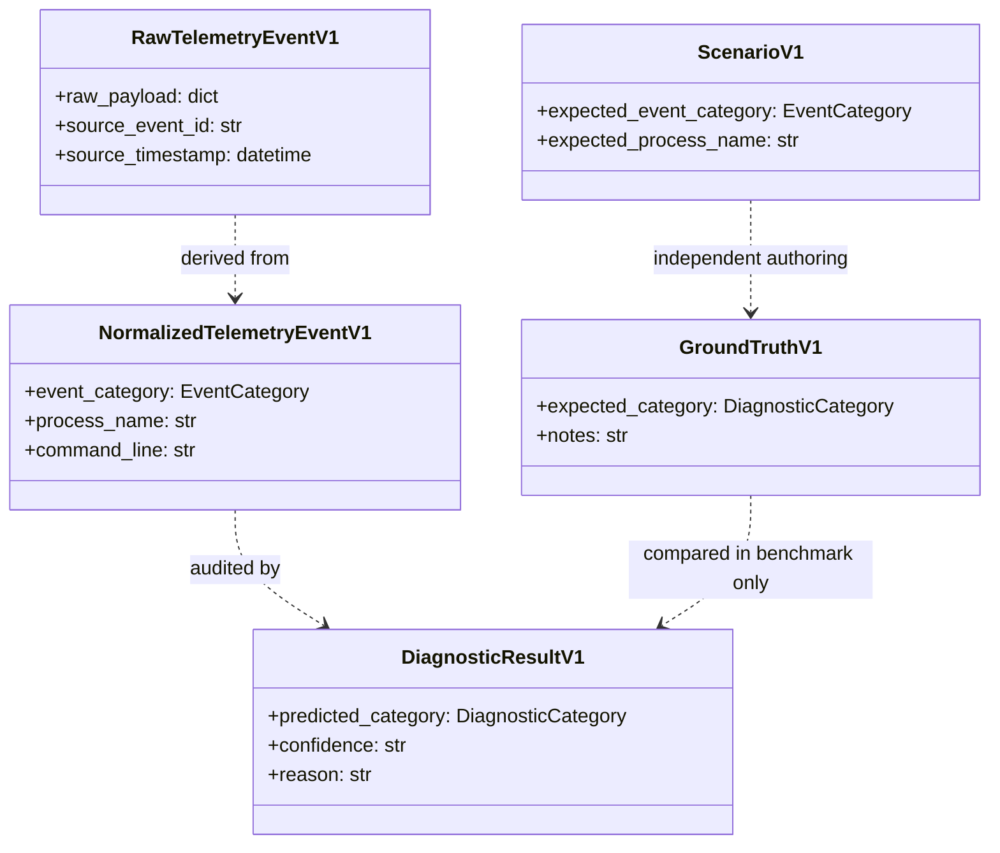
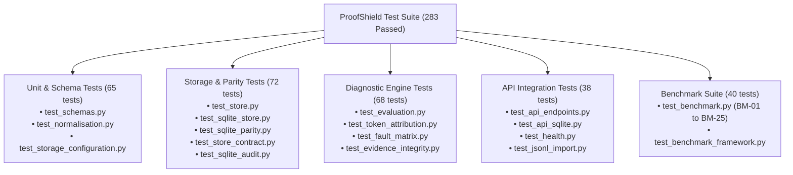

# PROOFSHIELD — Complete Architecture, Source Code & Developer Learning Guide

**Document Version:** 1.0.0  
**Target Repository:** `D:\PROOFSHIELD`  
**Target Audience:** Cybersecurity students, detection engineers, and developers seeking deep architectural mastery of ProofShield.  
**Classification System Used Throughout This Document:**
- **[Implemented]**: Verified by direct inspection of current source code in `src/proofshield/`.
- **[Tested]**: Verified by active passing tests in `tests/` (283 passing tests as of commit `b2f810b`).
- **[Documented]**: Described in project documentation (`README.md`, `docs/ARCHITECTURE.md`).
- **[Inferred]**: A logical engineering interpretation grounded in repository structure, but not explicitly stated in comments.
- **[Not Implemented]**: Absent from the inspected codebase (e.g., multi-record auditd joining, API telemetry persistence).
- **[Unverified]**: Could not be established from the local repository state.

---

## Table of Contents

1. [Chapter 1 — What Is ProofShield?](#chapter-1--what-is-proofshield)
2. [Chapter 2 — The Big-Picture Architecture](#chapter-2--the-big-picture-architecture)
3. [Chapter 3 — Repository Tour](#chapter-3--repository-tour)
4. [Chapter 4 — Essential Programming Concepts Used in ProofShield](#chapter-4--essential-programming-concepts-used-in-proofshield)
5. [Chapter 5 — Data Models and Schemas](#chapter-5--data-models-and-schemas)
6. [Chapter 6 — End-to-End Data Flow](#chapter-6--end-to-end-data-flow)
7. [Chapter 7 — Telemetry Normalization in Detail](#chapter-7--telemetry-normalization-in-detail)
8. [Chapter 8 — The Assurance Engine: The Most Important Chapter](#chapter-8--the-assurance-engine-the-most-important-chapter)
9. [Chapter 9 — Evidence Integrity and Ground Truth](#chapter-9--evidence-integrity-and-ground-truth)
10. [Chapter 10 — Storage Architecture](#chapter-10--storage-architecture)
11. [Chapter 11 — REST API and Request Lifecycle](#chapter-11--rest-api-and-request-lifecycle)
12. [Chapter 12 — Testing and Benchmarking](#chapter-12--testing-and-benchmarking)
13. [Chapter 13 — Configuration, Reliability, and Operational Behavior](#chapter-13--configuration-reliability-and-operational-behavior)
14. [Chapter 14 — Security Review](#chapter-14--security-review)
15. [Chapter 15 — Design Decisions and Trade-offs](#chapter-15--design-decisions-and-trade-offs)
16. [Chapter 16 — Current Limitations and Roadmap](#chapter-16--current-limitations-and-roadmap)
17. [Chapter 17 — Practical Developer Workflow](#chapter-17--practical-developer-workflow)
18. [Chapter 18 — Glossary and Concept Map](#chapter-18--glossary-and-concept-map)
19. [Part 3 — Pedagogical Materials](#part-3--pedagogical-materials)
    - [10 Essential Facts About ProofShield](#10-essential-facts-about-proofshield)
    - [One-Page Architecture Cheat Sheet](#one-page-architecture-cheat-sheet)
    - [Complete End-to-End Walkthrough in Plain English](#complete-end-to-end-walkthrough-in-plain-english)
    - [20 Study Questions (Beginner to Advanced)](#20-study-questions-beginner-to-advanced)
    - [10 Practical Local Exercises](#10-practical-local-exercises)
    - [Suggested 14-Day Learning Schedule](#suggested-14-day-learning-schedule)
    - [Self-Assessment Rubric](#self-assessment-rubric)
    - [Answer Key for Study Questions](#answer-key-for-study-questions)

---

# Chapter 1 — What Is ProofShield?

### Plain-English Explanation
Imagine you are testing the fire alarm system in a large skyscraper. You walk up to the 10th floor and pull the red alarm handle. You wait, but no sirens sound, no sprinklers activate, and no dispatchers call.

Why did the alarm fail?
1. Did the pull handle break in your hand before sending an electrical signal? (Execution Failure)
2. Did the sensor wire get severed between the 10th floor and the basement? (Sensor / Pipeline Failure)
3. Did the control computer receive the electrical signal, but its software rule was programmed to ignore 10th-floor alarms? (Detection Rule Defect)
4. Did the alarm bell actually ring, but it rang on the 2nd floor because of a wiring mistake? (Routing Misattribution)
5. Did someone pull a different alarm on the 1st floor at the exact same moment, tricking you into thinking your 10th-floor test succeeded? (Causal Confounding / False Pass)

In enterprise cybersecurity, security teams constantly run "attack simulations" (like Atomic Red Team) to test if their Security Information and Event Management (SIEM) systems detect hackers. When an attack simulation fails to generate an alert, engineers often blame the detection rule. But just like the fire alarm, the failure could be anywhere along the pipeline: the attack script crashed, the endpoint telemetry sensor (Sysmon/EDR) missed the event, the log forwarder suffered latency, or the alert fired under the wrong host ID.

**ProofShield is the automated diagnostic inspector for this detection pipeline.** It takes in the execution records of what was tested, the raw telemetry collected by sensors, and the alerts generated by monitoring systems. It then deterministically analyzes the entire evidence chain to tell security engineers *exactly* where and why the detection failed.

### Technical Explanation
**ProofShield** is an open, local-first, deterministic cybersecurity detection assurance and failure-diagnosis platform. Rather than acting as a sensor or an attack generator, ProofShield operates as an independent audit engine (Layer 5) evaluating the entire detection engineering lifecycle:
$$\text{Test Execution} \longrightarrow \text{Telemetry Generation} \longrightarrow \text{Telemetry Ingestion} \longrightarrow \text{Rule Evaluation} \longrightarrow \text{Alert Dispatch}$$

ProofShield addresses the "silent detection failure" problem by formally partitioning failure modes into seven mutually exclusive, mathematically defined diagnostic categories:
- `PASS` **[Implemented]**: The test executed, expected telemetry was observed, and the detection rule fired a verifiable, correlated alert.
- `TEST_NOT_EXECUTED` **[Implemented]**: The adversary emulator or test runner errored, failed, or halted before generating the requisite attack behaviors.
- `EXPECTED_TELEMETRY_MISSING` **[Implemented]**: The test executed, but endpoint sensors recorded no corresponding telemetry, indicating sensor blackout, driver unloads, or network transmission drops.
- `DETECTION_NOT_TRIGGERED` **[Implemented]**: Sensor telemetry reached the monitoring system within the testing window, but the detection rule failed to fire, indicating a rule logic flaw or threshold defect.
- `ALERT_NOT_CORRELATED` **[Implemented]**: The detection rule fired, but the resulting alert could not be correlated to the test run due to host misattribution or arrival outside the temporal window.
- `INCONCLUSIVE` **[Implemented]**: Telemetry or alerts were observed, but missing timestamps, conflicting execution tokens, or ambiguous rules prevent a definitive conclusion.
- `ERROR` **[Implemented]**: A system-level exception, missing scenario, or invalid configuration aborted evaluation.

### Comparison: ProofShield vs. Other Security Components

| Component | Primary Function | What It Generates / Consumes | Does ProofShield Replace It? |
| :--- | :--- | :--- | :--- |
| **SIEM** (e.g., Splunk, Microsoft Sentinel) | Centralized log aggregation, correlation, and search. | Consumes enterprise logs; generates alert records. | **No.** ProofShield ingests SIEM alerts as evidence to verify whether the SIEM did its job. |
| **EDR** (e.g., CrowdStrike Falcon, Microsoft Defender) | Endpoint monitoring, process telemetry collection, and active containment. | Ingests operating system activity; outputs telemetry and alerts. | **No.** ProofShield normalizes and inspects EDR telemetry to verify endpoint visibility. |
| **Attack Simulator** (e.g., Atomic Red Team, Caldera) | Executes offensive adversary techniques on endpoints. | Executes scripts/binaries; outputs execution status and tokens. | **No.** ProofShield uses simulation metadata (`TestRunV1`) to establish the test's scope and expected timeline. |
| **Detection Engine** (e.g., Sigma, Wazuh, Suricata) | Evaluates pattern-matching rules against incoming event streams. | Consumes normalized logs; fires alert notifications. | **No.** ProofShield audits the detection engine to identify whether rules fired or stayed silent. |
| **Conventional Testing Framework** (e.g., pytest) | Executes code assertions to verify software functionality. | Executes Python functions; reports assertion passes/fails. | **No.** Pytest tests ProofShield's internal code; ProofShield tests security operational environments. |

### Implemented vs. External Capabilities



- **What ProofShield implements [Implemented]**:
  1. Multi-format telemetry normalization (Sysmon XML/JSON, Linux auditd, Generic EDR, Fallback).
  2. Conflict-aware execution token extraction from command lines and structured payloads.
  3. Spatio-temporal and strict-token attribution engines.
  4. Dual storage backends: In-memory (`InMemoryStore`) and persistent SQLite (`SQLiteStore`) with full schema migrations, foreign keys, and WAL mode.
  5. 25-scenario benchmark test suite (BM-01 to BM-25) verifying 100% decision-path coverage.
  6. A complete FastAPI REST service with schema validation and JSONL stream ingestion.
- **What ProofShield depends on external tools to provide [Documented]**:
  1. Attack execution: ProofShield does not execute attacks on endpoints.
  2. Telemetry capture: ProofShield does not deploy endpoint sensor drivers (e.g., it does not run in the Windows kernel).
  3. SIEM rule evaluation: ProofShield does not evaluate real-time log streams against Sigma/Splunk syntax directly; it checks whether the SIEM produced the expected alert.

### Concrete Example: Diagnosing a Silent Failure
**Scenario:** Security Engineer Alice wants to validate MITRE ATT&CK Technique T1003.001 (OS Credential Dumping: LSASS Memory).
- **Target Host:** `WIN-SRV-01.corp.internal` (`10.0.4.50`)
- **Action:** A test runner executes `procdump.exe -ma lsass.exe lsass.dmp`.
- **Expected Rule:** `RULE-LSASS-DUMP-01`
- **Observed Outcome:** The SIEM dashboard is completely blank. No alert fired.

**Without ProofShield:**
The engineer assumes the detection rule `RULE-LSASS-DUMP-01` has broken logic. She spends four hours rewriting regex patterns in the SIEM, unaware that the rule was completely fine.

**With ProofShield:**
1. Alice imports the raw Sysmon logs and the test run metadata into ProofShield.
2. ProofShield normalizes the Sysmon telemetry and checks for `process_name: "procdump.exe"`.
3. ProofShield discovers zero process-creation events occurred within the test window (`window_start` to `window_end`).
4. ProofShield outputs:
   - **Verdict:** `EXPECTED_TELEMETRY_MISSING`
   - **Root Cause:** `TELEMETRY_MISSING`
   - **Reason:** *"No telemetry events observed within the test run observation window."*
5. Alice checks the endpoint and discovers the Sysmon service had crashed 10 minutes prior to the test. She fixes the sensor driver instead of corrupting a functioning detection rule.

---

# Chapter 2 — The Big-Picture Architecture

### Repository Architecture Inventory
ProofShield is structured into six discrete, decoupled architectural layers:



### Module Dependency Flow



### Component Breakdown & Architectural Inquiry

#### 1. Versioned Schemas (`src/proofshield/schemas/`)
- **What is it?** Pydantic v2 data models defining the strict structural contracts for every entity in ProofShield.
- **Why does it exist?** To enforce strict validation, type safety, and serialization rules across all boundaries.
- **What data does it receive?** Python dictionaries, JSON strings, or API request payloads.
- **What data does it produce?** Validated, immutable Python objects with explicit attributes.
- **Which modules call it?** Every single module in `src/proofshield/`.
- **Which modules does it depend on?** Standard library and Pydantic v2 (`pydantic.BaseModel`, `Field`).
- **What would break if removed?** The entire application would fail to compile; no data validation or serialization would occur.
- **Where is it implemented?** `src/proofshield/schemas/` (`telemetry.py`, `scenario.py`, `test_run.py`, `detection_rule.py`, `alert.py`, `ground_truth.py`, `diagnosis.py`, `common.py`).
- **Which tests verify it?** `tests/test_schemas.py`.

#### 2. Normalisation Engine (`src/proofshield/normalisation/`)
- **What is it?** A priority-dispatched plugin engine that converts heterogeneous raw sensor payloads into canonical normalized security events.
- **Why does it exist?** Endpoint sensors represent process execution, network connections, and file modifications in completely incompatible formats (e.g., Sysmon uses `Image`, auditd uses `exe`, CrowdStrike uses `process_path`).
- **What data does it receive?** `RawTelemetryEventV1` instances containing raw JSON payloads.
- **What data does it produce?** `NormalizedTelemetryEventV1` instances with preserved source IDs, timestamps, canonical category mappings, and extracted execution tokens.
- **Which modules call it?** `src/proofshield/api/routes_telemetry.py`, `scripts/demo.py`, benchmark suites.
- **Which modules does it depend on?** `src/proofshield/schemas/`, `dateutil`.
- **What would break if removed?** ProofShield would be blind to real-world sensor logs and unable to evaluate scenarios against Windows or Linux endpoint activity.
- **Where is it implemented?** `src/proofshield/normalisation/engine.py:763-787`.
- **Which tests verify it?** `tests/test_normalisation.py` (52 tests).

#### 3. Store Abstraction & Storage Implementations (`src/proofshield/services/`)
- **What is it?** `StoreProtocol` defines the interface; `InMemoryStore` and `SQLiteStore` provide the stateful implementations.
- **Why does it exist?** To decouple diagnostic reasoning from data persistence, allowing fast in-memory testing and durable, crash-resilient disk storage.
- **What data does it receive?** Scenarios, test runs, normalized events, detection rules, alerts, ground truth records, and diagnostic results.
- **What data does it produce?** Filtered, indexed, spatio-temporally correlated entity collections.
- **Which modules call it?** `src/proofshield/services/evaluation.py`, `src/proofshield/api/routes_evaluation.py`.
- **Which modules does it depend on?** `src/proofshield/schemas/`, `sqlite3`, `src/proofshield/config.py`.
- **What would break if removed?** The engine would have nowhere to store or query telemetry and alerts, crashing the evaluation pipeline.
- **Where is it implemented?** `src/proofshield/services/base_store.py`, `src/proofshield/services/store.py`, `src/proofshield/services/sqlite_store.py`.
- **Which tests verify it?** `tests/test_store.py`, `tests/test_sqlite_store.py`, `tests/test_sqlite_parity.py`, `tests/test_store_contract.py`.

#### 4. Deterministic Assurance Engine (`src/proofshield/services/evaluation.py`)
- **What is it?** The core reasoning engine of ProofShield (Layer 5).
- **Why does it exist?** To deterministically classify detection test outcomes into one of the seven formal diagnostic categories without guessing, LLM hallucination, or probabilistic heuristics.
- **What data does it receive?** A `run_id` and an optional `strict_attribution` boolean flag.
- **What data does it produce?** A complete `DiagnosticResultV1` record containing the predicted category, root cause failure category, confidence, supporting evidence IDs, contradictory evidence IDs, attribution metadata, and latency metrics.
- **Which modules call it?** `src/proofshield/api/routes_evaluation.py`, `scripts/demo.py`, `scripts/run_benchmark.py`.
- **Which modules does it depend on?** `src/proofshield/services/store.py`, `src/proofshield/schemas/`.
- **What would break if removed?** ProofShield would lose its diagnostic capabilities, degenerating into a simple data storage bucket.
- **Where is it implemented?** `src/proofshield/services/evaluation.py:52-954`.
- **Which tests verify it?** `tests/test_evaluation.py`, `tests/test_benchmark.py`, `tests/test_fault_matrix.py`, `tests/test_token_attribution.py`.

#### 5. REST API Layer (`src/proofshield/api/` & `src/proofshield/main.py`)
- **What is it?** A FastAPI-based HTTP server providing REST endpoints for external systems.
- **Why does it exist?** To allow CI/CD pipelines, security orchestration platforms (SOAR), and developers to ingest data and trigger diagnostic evaluations over standard HTTP.
- **What data does it receive?** HTTP JSON requests and URL query parameters.
- **What data does it produce?** HTTP JSON responses matching versioned Pydantic schemas.
- **Which modules call it?** External HTTP clients, curl, Postman, test clients.
- **Which modules does it depend on?** `fastapi`, `src/proofshield/services/`, `src/proofshield/normalisation/`, `src/proofshield/storage/`.
- **What would break if removed?** ProofShield could only be used as a Python library via scripts, losing all network-accessible API capabilities.
- **Where is it implemented?** `src/proofshield/main.py`, `src/proofshield/api/routes_health.py`, `src/proofshield/api/routes_telemetry.py`, `src/proofshield/api/routes_evaluation.py`.
- **Which tests verify it?** `tests/test_api_endpoints.py`, `tests/test_api_sqlite.py`, `tests/test_health.py`.

---

# Chapter 3 — Repository Tour

### Verified Directory Layout (`D:\PROOFSHIELD`)
```text
D:\PROOFSHIELD
│   .gitignore                          # Git ignore rules (Python, venv, caches)
│   pyproject.toml                      # Project metadata, dependencies, pytest configuration
│   README.md                           # Public repository overview and quickstart
│
├───docs
│       ARCHITECTURE.md                 # System architecture, formal specifications, benchmark metrics
│       PROOFSHIELD_LEARNING_GUIDE.md   # This comprehensive learning guide
│
├───fixtures                            # Canonical test datasets in JSONL format
│       alerts_v1.jsonl                 # Synthetic alerts for testing
│       detection_rules_v1.jsonl        # Detection rule definitions
│       ground_truth_v1.jsonl           # Benchmark oracle ground-truth labels
│       raw_telemetry_auditd_v1.jsonl   # Realistic Linux auditd raw records
│       raw_telemetry_malformed_v1.jsonl# Intentionally broken JSONL lines for error testing
│       raw_telemetry_realistic_v1.jsonl# Sysmon & EDR process/network records
│       raw_telemetry_valid_v1.jsonl    # Schema-compliant raw telemetry
│       scenarios_v1.jsonl              # Test scenarios (T1059, T1003, etc.)
│       test_runs_v1.jsonl              # Test execution records
│
├───scripts
│       demo.py                         # Standalone interactive terminal demonstration
│       run_benchmark.py                # Command-line benchmark harness (evaluates BM-01 to BM-25)
│
├───src
│   └───proofshield
│       │   config.py                   # Storage settings, environment variables, path validators
│       │   main.py                     # FastAPI application factory and lifespan manager
│       │   __init__.py                 # Package version definition (v0.1.0)
│       │
│       ├───api                         # REST API route handlers
│       │       routes_evaluation.py    # CRUD for scenarios, runs, rules, alerts, and /evaluation
│       │       routes_health.py        # /health and /api/v1/health endpoints
│       │       routes_telemetry.py     # /telemetry/raw, /telemetry/normalize, /ingest/jsonl
│       │       __init__.py
│       │
│       ├───normalisation               # Telemetry normalisation engine
│       │       base.py                 # BaseNormaliser abstract base class
│       │       engine.py               # Sysmon, Auditd, EDR, Fallback normalisers & token extraction
│       │       __init__.py
│       │
│       ├───schemas                     # Pydantic v2 data models
│       │       alert.py                # AlertV1 schema
│       │       common.py               # Enums (DiagnosticCategory, EventCategory, etc.)
│       │       detection_rule.py       # DetectionRuleV1 schema
│       │       diagnosis.py            # DiagnosticResultV1 schema
│       │       ground_truth.py         # GroundTruthV1 schema
│       │       scenario.py             # ScenarioV1 schema
│       │       telemetry.py            # RawTelemetryEventV1 and NormalizedTelemetryEventV1 schemas
│       │       test_run.py             # TestRunV1 schema
│       │       __init__.py
│       │
│       ├───services                    # Business logic and persistence
│       │       base_store.py           # StoreProtocol definition and UTC timestamp helper
│       │       evaluation.py           # AssuranceEngine deterministic diagnostic evaluator
│       │       sqlite_store.py         # SQLiteStore persistent relational adapter
│       │       store.py                # InMemoryStore indexed data registry and hosts_match()
│       │       __init__.py
│       │
│       └───storage                     # Ingestion utilities
│               jsonl_loader.py         # Streaming JSONL validator and file loader
│               __init__.py
│
└───tests                               # Pytest test suite (283 passing tests)
        conftest.py                     # Shared pytest fixtures (mock stores, temp DB paths)
        test_api_endpoints.py           # API integration tests for InMemoryStore backend
        test_api_sqlite.py              # API integration tests for SQLiteStore backend
        test_benchmark.py               # BM-01 to BM-25 synthetic benchmark evaluation tests
        test_benchmark_framework.py     # Benchmark metrics engine validation tests
        test_evaluation.py              # AssuranceEngine unit tests across diagnostic paths
        test_evidence_integrity.py      # Independent ground truth and evidence immutability tests
        test_fault_matrix.py            # Fault matrix FT-01 to FT-12 diagnostic failure tests
        test_health.py                  # Health check route verification
        test_jsonl_import.py            # Streaming JSONL parsing and line error tests
        test_normalisation.py           # Normalisation engine tests (Sysmon, auditd, EDR, fallback)
        test_operational_hardening.py   # Concurrency, edge-case, and fault-injection tests
        test_schemas.py                 # Pydantic v2 schema validation and serialization tests
        test_sqlite_audit.py            # SQLite schema audit, PRAGMA, and migration tests
        test_sqlite_parity.py           # Strict behavioral parity tests between InMemory and SQLite
        test_sqlite_store.py            # SQLiteStore CRUD and transaction unit tests
        test_storage_configuration.py   # StorageSettings and environment variable tests
        test_store.py                   # InMemoryStore CRUD and host matching unit tests
        test_store_contract.py          # Abstract StoreProtocol compliance test suite
        test_token_attribution.py       # Strict token attribution and causal confounding tests
```

### True Application Entry Points

1. **Running the REST API Server [Implemented]**:
   ```powershell
   .\.venv\Scripts\python.exe -m uvicorn proofshield.main:app --host 127.0.0.1 --port 8000 --reload
   ```
   - Target: `src/proofshield/main.py:app`
   - Spawns a local ASGI web server serving Swagger documentation at `http://127.0.0.1:8000/docs`.

2. **Running the Full Test Suite [Tested]**:
   ```powershell
   .\.venv\Scripts\python.exe -m pytest -q
   ```
   - Runs all 283 automated tests across 19 test modules.

3. **Running the Interactive Terminal Demo [Implemented]**:
   ```powershell
   .\.venv\Scripts\python.exe scripts/demo.py
   ```
   - Target: `scripts/demo.py:main`
   - Populates an in-memory database with representative test runs and prints an ASCII diagnostic scorecard.

4. **Running the Benchmark Evaluation Harness [Implemented]**:
   ```powershell
   .\.venv\Scripts\python.exe scripts/run_benchmark.py
   ```
   - Target: `scripts/run_benchmark.py:main`
   - Executes all 25 benchmark scenarios (BM-01 to BM-25), calculates formal accuracy and False-Diagnosis Rates, and generates confusion matrices.

---

# Chapter 4 — Essential Programming Concepts Used in ProofShield

As a cybersecurity student transitioning into software development, you will encounter Python constructs in ProofShield that differ from simple beginner scripts. This chapter teaches you every essential concept used in this repository.

---

### Concept 1: Type Hints and Optional Values

#### 1. Plain-English Explanation
When you fill out a passport application, certain boxes are mandatory (First Name, Date of Birth), while other boxes are optional (Middle Name). If you leave an optional box blank, it contains "nothing."
In Python, variables can hold anything by default. A **type hint** is an explicit note telling developers and tools: "This variable must be a string, and that variable must be an integer." When a field is optional, we mark it as `Optional[str]`, which means it can either hold a valid string or `None` (Python's word for "nothing").

#### 2. Source Code Example
In `src/proofshield/schemas/telemetry.py:48-52`:
```python
class NormalizedTelemetryEventV1(ProofshieldBaseModel):
    process_name: Optional[str] = Field(
        None,
        description="Clean executable image name (e.g. powershell.exe, cmd.exe)",
    )
    network_destination_port: Optional[int] = Field(
        None,
        ge=0,
        le=65535,
        description="Remote destination port for network connection events",
    )
```

#### 3. Line-by-Line Breakdown
- `process_name: Optional[str]`: Declares an attribute named `process_name` that may be a `str` (text) or `None`.
- `= Field(None, ...)`: Specifies that if a raw log does not contain a process name, Pydantic defaults it to `None` instead of throwing an error.
- `network_destination_port: Optional[int]`: Declares a port that may be an integer or `None`.
- `ge=0, le=65535`: Validation rules ensuring that if a port number *is* provided, it must be "greater than or equal to 0" and "less than or equal to 65535".

#### 4. Why ProofShield Uses It
A process-creation log has a process name but no destination port. A network log has a destination port but might not record a process name. Type hints prevent the code from crashing when fields are missing.

#### 5. Common Mistake / Failure Mode
Attempting to run string operations on an `Optional` variable without checking if it is `None`:
```python
# BUG: If event.process_name is None, this crashes with AttributeError!
if event.process_name.lower() == "cmd.exe":
    ...

# CORRECT (src/proofshield/services/evaluation.py:929-935):
if event.process_name:
    if event.process_name.lower() == "cmd.exe":
        ...
```

---

### Concept 2: Pydantic v2 Models and Validation

#### 1. Plain-English Explanation
Imagine a bouncer at a secure building who inspects your ID card. If your ID is expired, missing your photo, or has an invalid date, the bouncer immediately turns you away.
**Pydantic** is the software bouncer for ProofShield. When raw JSON arrives from the network or a file, Pydantic inspects every single field. If a field has the wrong type, is out of range, or is missing required information, Pydantic rejects it with a descriptive error before it can corrupt the system.

#### 2. Source Code Example
In `src/proofshield/schemas/scenario.py:18-35`:
```python
class ScenarioV1(ProofshieldBaseModel):
    schema_version: Literal["v1"] = "v1"
    scenario_id: str = Field(
        ...,
        min_length=3,
        description="Unique identifier for the scenario (e.g. SCN-T1059-001)",
    )
    mitre_technique_id: str = Field(
        ...,
        pattern=r"^T\d{4}(\.\d{3})?$",
        description="Primary MITRE ATT&CK technique ID (e.g. T1059.001)",
    )
```

#### 3. Line-by-Line Breakdown
- `class ScenarioV1(ProofshieldBaseModel)`: Defines a new data structure inheriting from ProofShield's base Pydantic model.
- `schema_version: Literal["v1"] = "v1"`: Enforces that the `schema_version` must literally be the text `"v1"`.
- `scenario_id: str = Field(..., min_length=3)`: The ellipsis `...` means this field is **mandatory**. If you attempt to create a scenario without an ID, validation fails.
- `pattern=r"^T\d{4}(\.\d{3})?$"`: A regular expression rule. It ensures that technique IDs strictly follow the MITRE format (e.g., `T1059` or `T1059.001`). If someone submits `"HACK-123"`, Pydantic rejects it immediately.

#### 4. Why ProofShield Uses It
Security testing requires reproducible, trustworthy data. If malformed data enters the engine, diagnostic verdicts become meaningless. Pydantic guarantees that any object circulating inside the code conforms 100% to specifications.

#### 5. Common Mistake / Failure Mode
Passing a dictionary directly into a function expecting a Pydantic model:
```python
# BUG: Passes a raw dict where a ScenarioV1 object is expected
scenario_dict = {
    "scenario_id": "SCN-01",
    "name": "Process Injection Validation",
    "mitre_technique_id": "T1055",
    "mitre_tactic": "Defense Evasion",
    "expected_event_category": "PROCESS_CREATION",
}
engine._find_matching_events(scenario_dict, events) # Crashes!

# CORRECT:
scenario = ScenarioV1.model_validate(scenario_dict)
engine._find_matching_events(scenario, events)
```

---

### Concept 3: Enums and Literal Values

#### 1. Plain-English Explanation
If a form asks for your "Status", you shouldn't be allowed to type whatever you want (like "kinda running", "almost done", or "idk"). The form should give you a fixed dropdown menu with strict choices: `RUNNING`, `COMPLETED`, or `FAILED`.
In Python, an **Enum** (short for Enumeration) is a fixed list of allowed choices. A **Literal** is a type hint that restricts a variable to an exact, specific value.

#### 2. Source Code Example
In `src/proofshield/schemas/common.py:46-55`:
```python
class DiagnosticCategory(str, Enum):
    PASS = "PASS"
    TEST_NOT_EXECUTED = "TEST_NOT_EXECUTED"
    EXPECTED_TELEMETRY_MISSING = "EXPECTED_TELEMETRY_MISSING"
    DETECTION_NOT_TRIGGERED = "DETECTION_NOT_TRIGGERED"
    ALERT_NOT_CORRELATED = "ALERT_NOT_CORRELATED"
    INCONCLUSIVE = "INCONCLUSIVE"
    ERROR = "ERROR"
```

#### 3. Line-by-Line Breakdown
- `class DiagnosticCategory(str, Enum)`: Creates an Enum where each option is also a string.
- `PASS = "PASS"`: Defines the allowed constant. You reference it in code as `DiagnosticCategory.PASS`.

#### 4. Why ProofShield Uses It
Enums eliminate typos. If you accidentally write `"PASSS"` or `"pass"`, Python raises a `ValueError` during compilation/testing rather than silently producing incorrect metrics in production.

#### 5. Common Mistake / Failure Mode
Comparing an Enum object to a string with inconsistent casing:
```python
# MISTAKE:
if result.predicted_category == "pass": # Evaluates to False!
    ...

# CORRECT:
if result.predicted_category == DiagnosticCategory.PASS:
    ...
```

---

### Concept 4: Protocols and Structural Typing

#### 1. Plain-English Explanation
Imagine you buy a universal remote control. The remote doesn't care whether your television was made by Sony, Samsung, or LG. As long as your TV understands the command "Power Button", the remote works.
In traditional object-oriented programming, classes must explicitly say `class SonyTV(Television)`. In modern Python, a **Protocol** is an interface contract: "I don't care what class you are; as long as you have an `add_scenario()` method and a `get_run()` method, you are allowed to be my Store."

#### 2. Source Code Example
In `src/proofshield/services/base_store.py:27-46`:
```python
from typing import Protocol, runtime_checkable

@runtime_checkable
class StoreProtocol(Protocol):
    def add_scenario(self, scenario: ScenarioV1) -> ScenarioV1: ...
    def get_scenario(self, scenario_id: str) -> Optional[ScenarioV1]: ...
    def add_run(self, run: TestRunV1) -> TestRunV1: ...
    def get_run(self, run_id: str) -> Optional[TestRunV1]: ...
    def get_events_for_run(self, run: TestRunV1) -> List[NormalizedTelemetryEventV1]: ...
```

#### 3. Line-by-Line Breakdown
- `@runtime_checkable`: Allows us to use `isinstance(obj, StoreProtocol)` in tests to verify if an object satisfies the contract.
- `class StoreProtocol(Protocol)`: Declares that this class is an interface specification, not an actual storage implementation.
- `def add_scenario(self, ...) -> ScenarioV1: ...`: Declares that any valid storage engine *must* have an `add_scenario` method accepting a `ScenarioV1` and returning a `ScenarioV1`. The ellipsis `...` means there is no code here—it is purely a blueprint.

#### 4. Why ProofShield Uses It
ProofShield has two storage backends: `InMemoryStore` (fast, for tests) and `SQLiteStore` (durable, for real disks). Because both implement `StoreProtocol`, the `AssuranceEngine` can evaluate test runs against either backend without changing a single line of code.

#### 5. Common Mistake / Failure Mode
Adding a new method to `InMemoryStore` but forgetting to add it to `SQLiteStore`. The compiler won't warn you until someone switches to SQLite in production and crashes with `AttributeError`.

---

### Concept 5: Dependency Injection in FastAPI

#### 1. Plain-English Explanation
Instead of building a car engine inside your kitchen every time you want to drive to the grocery store, you borrow or rent an already-built car.
In web development, **Dependency Injection** means a function doesn't create its own database connection from scratch. Instead, the web framework (FastAPI) automatically "injects" the active database connection into the function's parameters when an HTTP request arrives.

#### 2. Source Code Example
In `src/proofshield/api/routes_evaluation.py:27-31`:
```python
@router.post("/scenarios", response_model=ScenarioV1)
def create_scenario(scenario: ScenarioV1) -> ScenarioV1:
    """Register a new scenario in the active store."""
    store = get_store()
    try:
        return store.add_scenario(scenario)
    except ValueError as exc:
        raise HTTPException(status_code=409, detail=str(exc))
```

#### 3. Line-by-Line Breakdown
- `@router.post("/scenarios")`: Tells FastAPI to run this function whenever a client sends an HTTP `POST` request to `/api/v1/scenarios`.
- `scenario: ScenarioV1`: FastAPI automatically reads the incoming HTTP JSON body, validates it against `ScenarioV1`, and passes the parsed object into the function.
- `store = get_store()`: Retrieves the globally configured storage instance (either `InMemoryStore` or `SQLiteStore` depending on environment configuration).

#### 4. Why ProofShield Uses It
It decouples API endpoints from physical database management. In unit tests, `get_store()` can provide a fresh, isolated temporary database, while in production it provides a persistent file-backed SQLite database.

#### 5. Common Mistake / Failure Mode
Creating a brand new database connection inside every request handler, which exhausts operating system file handles and causes database lock contention under load.

---

### Concept 6: Database Transactions and Savepoints

#### 1. Plain-English Explanation
Imagine transferring $100 from your checking account to your savings account. The bank must do two things: (1) subtract $100 from checking, and (2) add $100 to savings. If the power cuts out after step 1 but before step 2, your money vanishes!
A **Database Transaction** bundles multiple database operations into a single all-or-nothing package (`commit`). If anything fails along the way, the database undoes every change (`rollback`), leaving the data completely safe. A **Savepoint** is like a checkpoint inside a video game: you can roll back to the checkpoint without restarting the entire level.

#### 2. Source Code Example
In `src/proofshield/services/sqlite_store.py:228-251`:
```python
@contextmanager
def transaction(self) -> Generator[sqlite3.Cursor, None, None]:
    """Provide transactional context manager with nested savepoint support."""
    self._check_open()
    cursor = self.connection.cursor()
    with self._lock:
        is_outer = (self._savepoint_counter == 0)
        self._savepoint_counter += 1
        sp_name = f"sp_{self._savepoint_counter}"
        cursor.execute(f"SAVEPOINT {sp_name};")
        try:
            yield cursor
            cursor.execute(f"RELEASE SAVEPOINT {sp_name};")
        except Exception:
            cursor.execute(f"ROLLBACK TO SAVEPOINT {sp_name};")
            cursor.execute(f"RELEASE SAVEPOINT {sp_name};")
            raise
        finally:
            self._savepoint_counter -= 1
```

#### 3. Line-by-Line Breakdown
- `@contextmanager`: Allows this function to be used in Python's `with store.transaction() as cursor:` syntax.
- `with self._lock:`: Thread lock ensuring multiple threads don't corrupt the database simultaneously.
- `cursor.execute(f"SAVEPOINT {sp_name};")`: Sets a rollback checkpoint.
- `yield cursor`: Hands control over to the developer to run `INSERT` or `UPDATE` queries.
- `RELEASE SAVEPOINT`: If no errors occurred, permanently saves the changes.
- `ROLLBACK TO SAVEPOINT`: If any Python exception was thrown, instantly undoes all changes made during the `with` block.

#### 4. Why ProofShield Uses It
When storing complex entities (e.g., a test run with 50 telemetry events), an unexpected crash halfway through must not leave orphaned records in the database.

#### 5. Common Mistake / Failure Mode
Forgetting to commit or close a transaction, leaving the SQLite database permanently locked and freezing all other API requests with a timeout error (`sqlite3.OperationalError: database is locked`).

---

### Concept 7: Deterministic Evaluation vs. Probabilistic Guessing

#### 1. Plain-English Explanation
If a smoke detector goes off, you don't want an AI guessing: *"I am 73% confident there might be a fire because today is Tuesday."* You want an electrical circuit that says: *"Smoke particle density exceeded 15 ppm for 3 consecutive seconds; therefore, sound the siren."*
**Deterministic logic** means that if you feed the exact same inputs into a system 1,000 times, you are mathematically guaranteed to get the exact same output 1,000 times. There are no random numbers, no machine learning hallucinations, and no time-of-day biases.

#### 2. Source Code Example
In `src/proofshield/services/evaluation.py:215-237`:
```python
# Deterministic Step 1: Check execution status
if run.execution_status in (
    ExecutionStatus.FAILED,
    ExecutionStatus.ERROR,
    ExecutionStatus.PENDING,
):
    return self._make_result(
        run=run,
        scenario=scenario,
        category=DiagnosticCategory.TEST_NOT_EXECUTED,
        reason=(
            f"Test execution reported as {run.execution_status.value} "
            f"before producing intended behaviour"
        ),
        confidence="definitive",
    )
```

#### 3. Line-by-Line Breakdown
- If `run.execution_status` is `FAILED`, the engine does not inspect alerts, does not query the SIEM, and does not guess.
- It immediately returns `DiagnosticCategory.TEST_NOT_EXECUTED` with `confidence="definitive"`.

#### 4. Why ProofShield Uses It
In cybersecurity, false confidence is dangerous. If an audit platform says a detection test failed, security teams must be able to prove in court or compliance audits *exactly* which if-statement produced that verdict.

#### 5. Common Mistake / Failure Mode
Using `datetime.now()` inside decision logic instead of comparing the event timestamps recorded in the logs. This makes tests unreproducible because the outcome depends on what second you ran the test script.

---

### Concept 8: Pytest Fixtures and Parametrization

#### 1. Plain-English Explanation
Imagine an automotive crash-test facility. Before testing a car, technicians clean the track, reset the high-speed cameras, and install a brand-new test dummy. After the crash, they sweep up the debris so the next car starts on a clean track.
In testing, a **Fixture** is the setup and cleanup crew. It gives your test a clean, freshly initialized database before the test runs, and deletes it when the test finishes. **Parametrization** means running the exact same test 10 times with 10 different inputs (like testing the seatbelt with a child dummy, an adult dummy, and an oversized dummy).

#### 2. Source Code Example
In `tests/test_benchmark.py:32-38`:
```python
@pytest.mark.parametrize("scenario_id,expected_category", [
    ("BM-01", DiagnosticCategory.PASS),
    ("BM-02", DiagnosticCategory.TEST_NOT_EXECUTED),
    ("BM-03", DiagnosticCategory.EXPECTED_TELEMETRY_MISSING),
    ("BM-04", DiagnosticCategory.DETECTION_NOT_TRIGGERED),
    ("BM-05", DiagnosticCategory.ALERT_NOT_CORRELATED),
    ("BM-06", DiagnosticCategory.INCONCLUSIVE),
])
def test_benchmark_scenarios(scenario_id: str, expected_category: DiagnosticCategory, populated_store):
    engine = AssuranceEngine(populated_store)
    result = engine.evaluate_run(f"RUN-{scenario_id}")
    assert result.predicted_category == expected_category
```

#### 3. Line-by-Line Breakdown
- `@pytest.mark.parametrize`: Pytest runs `test_benchmark_scenarios` 6 separate times, automatically feeding in the `scenario_id` and `expected_category`.
- `populated_store`: A fixture defined in `tests/conftest.py` that automatically loads the benchmark scenarios into memory before each test runs.
- `assert result.predicted_category == expected_category`: Verifies that the engine's verdict matches ground truth. If it doesn't, the test fails.

#### 4. Why ProofShield Uses It
ProofShield has 283 tests. Running them manually would take hours. Pytest executes all 283 tests in under 3 seconds, guaranteeing that any code changes do not break existing functionality.

#### 5. Common Mistake / Failure Mode
Sharing a mutable global database between tests. If Test 1 modifies the database and fails to clean up, Test 2 will randomly fail because of leftover data from Test 1.

---

# Chapter 5 — Data Models and Schemas

ProofShield defines eight versioned entities in Layer 1 (`src/proofshield/schemas/`). Every entity inherits from `ProofshieldBaseModel` (`schemas/common.py`), which configures Pydantic to forbid extra attributes (`extra = "forbid"`), validate field assignments, and enforce ISO 8601 formatting.



---

### Detailed Entity Specification

#### 1. `RawTelemetryEventV1` (`schemas/telemetry.py`)
- **Purpose**: Unaltered evidence container preserving original sensor logs as emitted by operating system agents.
- **Fields**:
  - `schema_version`: `Literal["v1"]` (Default: `"v1"`).
  - `raw_event_id`: `str` (Required, min length 3, e.g., `RAW-001`).
  - `source_format`: `str` (Required, e.g., `sysmon`, `auditd`, `edr`, `generic`).
  - `source_event_id`: `str` (Required; preserves original sensor ID like Windows Event Record ID or audit serial).
  - `source_timestamp`: `datetime` (Required; original sensor collection timestamp).
  - `ingested_at`: `datetime` (Required; timestamp when ProofShield received the event).
  - `raw_payload`: `Dict[str, Any]` (Required; complete unaltered JSON dictionary from sensor).
- **Persistence**: Persisted via `store.add_raw_event()`. Table: `raw_telemetry`.
- **Tests**: `tests/test_schemas.py:15-30`.

#### 2. `NormalizedTelemetryEventV1` (`schemas/telemetry.py`)
- **Purpose**: Canonical representation of security events across Windows, Linux, and cloud endpoints.
- **Key Fields**:
  - `normalized_event_id`: `str` (Required, e.g., `NORM-A1B2C3D4E5F6`).
  - `raw_event_id`: `str` (Required foreign reference to `RawTelemetryEventV1`).
  - `source_event_id`: `str` (Required; strictly preserved from raw log).
  - `source_timestamp`: `datetime` (Required; strictly preserved from raw log).
  - `normalized_timestamp`: `datetime` (Required; canonical UTC timestamp).
  - `event_category`: `EventCategory` enum (`PROCESS_CREATION`, `NETWORK_CONNECTION`, `FILE_EVENT`, `REGISTRY_EVENT`, `AUTHENTICATION`, `OTHER`).
  - `host`: `str` (Required; canonicalized target hostname or IP).
  - `user`: `Optional[str]` (Target user account).
  - `process_name`: `Optional[str]` (Clean executable name, e.g., `cmd.exe`).
  - `process_path`: `Optional[str]` (Full binary path, e.g., `C:\Windows\System32\cmd.exe`).
  - `command_line`: `Optional[str]` (Command arguments).
  - `parent_process_name`: `Optional[str]`.
  - `hashes`: `Dict[str, str]` (Normalized dictionary: `{"sha256": "...", "md5": "..."}`).
  - `network_destination_ip`: `Optional[str]`.
  - `network_destination_port`: `Optional[int]` (0–65535).
  - `execution_token`: `Optional[str]` (Extracted execution provenance token).
  - `extra_attributes`: `Dict[str, Any]` (Preserved unmapped attributes).
- **Persistence**: Persisted via `store.add_normalized_event()`. Table: `normalized_telemetry`.
- **Tests**: `tests/test_normalisation.py`, `tests/test_schemas.py`.

#### 3. `ScenarioV1` (`schemas/scenario.py`)
- **Purpose**: Independent specification of the adversary technique under test and the expected detection response.
- **Key Fields**:
  - `scenario_id`: `str` (Required, e.g., `SCN-T1059-001`).
  - `name`: `str` (Required human-readable description).
  - `mitre_technique_id`: `str` (Required, pattern `^T\d{4}(\.\d{3})?$`).
  - `mitre_tactic`: `str` (e.g., `Execution`, `Persistence`).
  - `expected_event_category`: `EventCategory` (Category expected from sensors).
  - `expected_process_name`: `Optional[str]` (Process signature to match).
  - `expected_command_pattern`: `Optional[str]` (Regex pattern to match against command line).
  - `expected_detection_rule_id`: `Optional[str]` (Rule ID expected to fire in SIEM).
  - `expected_destination_ip`: `Optional[str]` (Expected destination IP for network telemetry).
  - `expected_destination_port`: `Optional[int]` (Expected destination port [0-65535]).
  - `expected_file_path`: `Optional[str]` (Expected file path or target filename).
  - `expected_file_hash`: `Optional[str]` (Expected cryptographic hash e.g. SHA256).
  - `expected_user`: `Optional[str]` (Expected user account or UID).
  - `max_acceptable_latency_seconds`: `int = 300` (Maximum tolerable delay from execution to alert).
  - `validation_target`: `ValidationTarget` enum (`EXPECTED_ALERT`, `EXPECTED_TELEMETRY_ONLY`, `EXPECTED_BENIGN`).
- **Persistence**: Persisted via `store.add_scenario()`. Table: `scenarios`.
- **Tests**: `tests/test_schemas.py`.

#### 4. `TestRunV1` (`schemas/test_run.py`)
- **Purpose**: Record of an actual attack simulation executed on an endpoint.
- **Key Fields**:
  - `run_id`: `str` (Required, e.g., `RUN-001`).
  - `scenario_id`: `str` (Required foreign key referencing `ScenarioV1`).
  - `execution_mode`: `ExecutionMode` enum (`SYNTHETIC_SIMULATION`, `EMULATED_AGENT`, `RECORDED_PLAYBACK`, `MANUAL_TEST`).
  - `is_synthetic`: `bool` (Explicit flag ensuring synthetic data is never misrepresented as live execution; default `True`).
  - `target_host`: `str` (Required target host, e.g., `WIN-SRV-01`).
  - `target_user`: `str` (Required target username / account).
  - `window_start`: `datetime` (Required UTC start of telemetry observation window).
  - `window_end`: `datetime` (Required UTC end of telemetry observation window; must be $\ge$ `window_start`).
  - `executed_at`: `datetime` (Required UTC timestamp when test execution commenced).
  - `execution_status`: `ExecutionStatus` enum (`COMPLETED`, `RUNNING`, `FAILED`, `ERROR`, `PENDING`).
  - `execution_token`: `Optional[str]` (Optional unique run tag, e.g., `TOK-RUN-01`).
  - `metadata`: `Dict[str, Any]` (Additional execution data).
- **Persistence**: Persisted via `store.add_run()`. Table: `test_runs`.
- **Tests**: `tests/test_schemas.py`.

#### 5. `DetectionRuleV1` (`schemas/detection_rule.py`)
- **Purpose**: Versioned record of detection logic deployed in the SIEM/EDR.
- **Key Fields**:
  - `rule_id`: `str` (Required unique rule ID, e.g., `RULE-001`).
  - `rule_name`: `str` (Required human-readable rule name).
  - `rule_version`: `str` (Semantic version, default: `"1.0.0"`).
  - `rule_format`: `str` (e.g., `sigma`, `splunk_spl`, `wazuh_xml`).
  - `rule_content`: `Optional[str]` (Raw rule definition text).
  - `rule_content_hash`: `Optional[str]` (SHA-256 hash for change tracking).
  - `evaluation_backend`: `Optional[str]` (e.g., `splunk`, `elastic`, `wazuh`).
  - `enabled`: `bool` (Whether rule is active, default: `True`).
  - `description`: `str` (Detection description).
  - `mitre_technique_ids`: `List[str]` (MITRE technique IDs covered).
- **Persistence**: Persisted via `store.add_rule()`. Table: `detection_rules`.
- **Tests**: `tests/test_schemas.py`.

#### 6. `AlertV1` (`schemas/alert.py`)
- **Purpose**: Security notification generated by the SIEM/monitoring system.
- **Key Fields**:
  - `alert_id`: `str` (Required unique alert ID, e.g., `ALT-001`).
  - `source_alert_id`: `str` (Original alert ID from source monitoring system).
  - `source_type`: `str` (Source monitoring system e.g. `wazuh`, `splunk`, `sentinel`).
  - `host_id`: `str` (Required host where alert fired).
  - `rule_reference`: `Optional[str]` (Detection rule ID referencing `DetectionRuleV1`).
  - `alert_timestamp`: `Optional[datetime]` (Time alert was generated; if missing, treated with suspicion).
  - `ingested_at`: `Optional[datetime]` (Time alert was ingested by ProofShield).
  - `alert_title`: `Optional[str]` (Human-readable alert title).
  - `severity`: `Optional[str]` (Severity level: `low`, `medium`, `high`, `critical`).
  - `execution_token`: `Optional[str]` (Execution token extracted from alert details).
  - `raw_alert_payload`: `Dict[str, Any]` (Unaltered alert dictionary).
- **Persistence**: Persisted via `store.add_alert()`. Table: `alerts`.
- **Tests**: `tests/test_schemas.py`.

#### 7. `GroundTruthV1` (`schemas/ground_truth.py`)
- **Purpose**: Independently authored expected diagnostic outcome used exclusively to score benchmark accuracy.
- **Key Fields**:
  - `ground_truth_id`: `str` (Required unique ground truth ID).
  - `run_id`: `str` (Required reference to the associated `TestRunV1`).
  - `expected_diagnostic_category`: `DiagnosticCategory` (Independently verified expected diagnostic outcome).
  - `verification_method`: `str` (Method used to verify ground truth, e.g. `manual_inspection`, `independent_log`).
  - `injected_fault_type`: `Optional[str]` (Type of fault injected e.g. `telemetry_drop`, `rule_disable`).
  - `verification_evidence`: `Optional[str]` (Reference to evidence supporting label).
  - `label_status`: `str` (Status: `confirmed`, `provisional`, `disputed`).
  - `metadata`: `Dict[str, Any]` (Additional ground truth metadata).
- **Persistence**: Persisted via `store.add_ground_truth()`. Table: `ground_truth`.
- **Tests**: `tests/test_evidence_integrity.py`.

#### 8. `DiagnosticResultV1` (`schemas/diagnosis.py`)
- **Purpose**: Final diagnostic verdict and root-cause analysis produced by the Assurance Engine.
- **Key Fields**:
  - `diagnostic_id`: `str` (Required, e.g., `DIAG-UUID`).
  - `test_run_id`: `str` (Required reference to evaluated `TestRunV1`).
  - `scenario_id`: `str` (Required reference to `ScenarioV1`).
  - `predicted_category`: `DiagnosticCategory` (One of the 7 formal categories).
  - `failure_category`: `Optional[FailureCategory]` (Root cause: `TELEMETRY_MISSING`, `PIPELINE_LATENCY`, `DETECTION_RULE_MISMATCH`, `ALERT_SUPPRESSED`, etc.).
  - `confidence`: `str` (`definitive`, `likely`, `uncertain`).
  - `reason`: `str` (Primary plain-language justification).
  - `diagnostic_reasons`: `List[str]` (Step-by-step evidence audit trail).
  - `supporting_evidence_ids`: `List[str]` (IDs of events/alerts supporting verdict).
  - `contradictory_evidence_ids`: `List[str]` (IDs of events/alerts contradicting verdict).
  - `evaluated_at`: `datetime` (UTC timestamp of evaluation).
  - `engine_version`: `str` (Engine release version, e.g., `v0.1.0`).
  - `metadata`: `Dict[str, Any]` (Attribution status, token maps, latency calculations).
- **Persistence**: Persisted via `store.add_result()`. Table: `diagnostic_results`.
- **Tests**: `tests/test_evaluation.py`.

---

### Record Evolution Walkthrough

```text
1. RAW SENSOR LOG (JSON on disk):
   {"EventID": 1, "Image": "C:\\Windows\\System32\\cmd.exe", "CommandLine": "cmd.exe /c whoami --token=TOK-99", "UtcTime": "2026-10-24 01:00:00.000"}

2. RAW INGESTION (RawTelemetryEventV1):
   raw_event_id="RAW-001", source_format="sysmon", source_event_id="101"

3. NORMALISATION (SysmonNormaliser):
   event_category=PROCESS_CREATION, process_name="cmd.exe", execution_token="TOK-99"

4. STORAGE (SQLiteStore / InMemoryStore):
   Indexed under host "WIN-SRV-01" at timestamp "2026-10-24T01:00:00Z"

5. CORRELATION WITH RUN (TestRunV1):
   Matched to RUN-01 (target_host="WIN-SRV-01", window=00:59:00 to 01:05:00, execution_token="TOK-99")

6. EVALUATION WITH SCENARIO (ScenarioV1):
   Scenario expects process_name="cmd.exe" and detection_rule_id="RULE-CMD-01"

7. ALERT CORRELATION (AlertV1):
   Found ALT-88 from RULE-CMD-01 on WIN-SRV-01 with execution_token="TOK-99"

8. DIAGNOSTIC VERDICT (DiagnosticResultV1):
   predicted_category=PASS, confidence="definitive", supporting_evidence=["NORM-RAW-001", "ALT-88"]
```

---

# Chapter 6 — End-to-End Data Flow

The following sequence diagram illustrates the complete, deterministic execution flow from raw log ingestion through to diagnostic verdict generation.



### Trace of Individual Steps

1. **Raw Ingestion**: Telemetry arrives via JSONL file or API body. Validated by `RawTelemetryEventV1`.
2. **Normalisation Dispatch**: `NormalisationEngine.normalize()` loops through registered normalisers:
   - `SysmonNormaliser.can_handle(raw_event)`
   - `AuditdNormaliser.can_handle(raw_event)`
   - `GenericEDRNormaliser.can_handle(raw_event)`
   - `FallbackNormaliser.can_handle(raw_event)` (Always returns `True`).
3. **Field Extraction & Token Parsing**: Selected normaliser maps vendor fields into canonical fields and invokes `extract_execution_token()`.
4. **Persistence & Storage Modes**:
   - In direct service calls, benchmarks, and scripts: Normalized events are stored via `store.add_normalized_event()`.
   - In the REST API (`routes_telemetry.py:171-260`): `POST /telemetry/raw` and `POST /telemetry/normalize` default to validation without storage, but will persist records directly when called with query parameter `?store=true`. Batch JSONL ingestion (`POST /ingest/jsonl`) also supports optional persistence with `?store=true`.
5. **Scenario & Run Registration**: `POST /api/v1/scenarios` and `POST /api/v1/runs` persist metadata to `store`.
6. **Triggering Evaluation**: Client calls `POST /api/v1/evaluation/{run_id}`.
7. **Entity Verification**: `AssuranceEngine.evaluate_run()` queries `store.get_run()` and `store.get_scenario()`.
8. **Execution Check**: Evaluates `run.execution_status`.
9. **Spatio-Temporal Event Retrieval**: Calls `store.get_events_for_run(run)`, filtering by host matching (`hosts_match`) and time window ($[\text{start}, \text{end}]$).
10. **Signature Matching**: Filters events against `expected_event_category`, `expected_process_name`, and `expected_command_pattern`.
11. **Alert Retrieval & Grace Period**: Queries alerts for the expected rule spanning $[\text{window\_start} - \text{grace}, \text{window\_end} + \text{grace}]$ (default grace period: 3,600s).
12. **Attribution & Classification**: Evaluates token continuity or spatio-temporal correlation, constructs `DiagnosticResultV1`, persists to `store`, and returns.

---

# Chapter 7 — Telemetry Normalization in Detail

### Normaliser Dispatch and Precedence
The normalisation engine (`src/proofshield/normalisation/engine.py:763-787`) evaluates normalisers in a strict, deterministic sequence:
1. `SysmonNormaliser` (Priority 1)
2. `AuditdNormaliser` (Priority 2)
3. `GenericEDRNormaliser` (Priority 3)
4. `FallbackNormaliser` (Priority 4 — Catch-all)

If two normalisers could theoretically accept a payload, the normaliser registered earlier in the list wins.



---

### Detailed Provider Implementations

#### 1. `SysmonNormaliser` (`engine.py:228-348`)
- **Recognition Logic**: Checks if `source_format` is `"sysmon"` or if `"EventID"` exists in `raw_payload`.
- **Supported Event IDs**:
  - `EventID: 1` $\longrightarrow$ `EventCategory.PROCESS_CREATION`.
    - Maps `Image` to `process_path` and extracts basename to `process_name`.
    - Maps `CommandLine` to `command_line`.
    - Maps `ParentImage` to `parent_process_name`.
    - Parses `Hashes` via `_parse_hashes()`.
  - `EventID: 3` $\longrightarrow$ `EventCategory.NETWORK_CONNECTION`.
    - Maps `DestinationIp` to `network_destination_ip`.
    - Maps `DestinationPort` to `network_destination_port` (validating range 0–65535).
- **Preservation Guarantee**: Copies unmapped Sysmon XML attributes into `extra_attributes`. Preserves original `source_event_id` and UTC `source_timestamp`.

#### 2. `AuditdNormaliser` (`engine.py:465-695`)
- **Recognition Logic**: Checks if `source_format` is `"auditd"`, `"linux_audit"`, or if `"syscall"`, `"audit_id"`, or `"serial"` exist in payload.
- **Category Resolution**:
  - `EXECVE` record or `syscall` $\in$ `{execve, execveat}` $\longrightarrow$ `EventCategory.PROCESS_CREATION`.
  - `SOCKADDR` record or `syscall` $\in$ `{connect, accept, bind}` $\longrightarrow$ `EventCategory.NETWORK_CONNECTION`.
  - `USER_AUTH`, `USER_LOGIN` $\longrightarrow$ `EventCategory.AUTHENTICATION`.
  - `PATH` with `nametype` $\in$ `{CREATE, DELETE}` or `unlink` $\longrightarrow$ `EventCategory.FILE_EVENT`.
- **Sockaddr Decoding**: Parses raw hex strings (e.g., `020000507F000001...`). Decodes family (`0200` = `AF_INET`), extracting destination port `80` (`0x0050`) and IP `127.0.0.1` (`0x7F000001`).
- **Documented Architectural Limitation [Documented]**: Real Linux auditd emits multi-record events sharing an audit serial number (a `SYSCALL` record followed by separate `EXECVE`, `CWD`, and `PATH` records). ProofShield currently normalizes auditd records **one record at a time**. Multi-record joining across lines is a planned Phase 9 enhancement.

#### 3. `GenericEDRNormaliser` (`engine.py:349-464`)
- **Recognition Logic**: Matches common flat EDR schemas (CrowdStrike, Defender, SentinelOne). Rejects payloads bearing Sysmon or auditd signatures.
- **Field Discovery**: Checks alternative naming patterns (e.g., `process_path` vs `binary_path` vs `image`; `cmdline` vs `command_line`).

#### 4. `FallbackNormaliser` (`engine.py:698-761`)
- **Recognition Logic**: Guaranteed catch-all (`can_handle()` always returns `True`).
- **Preservation Guarantee**: Performs best-effort discovery for host and user, maps category to `EventCategory.OTHER`, and dumps the entire unaltered dictionary into `extra_attributes`. Zero data loss.

---

### Execution Token Extraction (`engine.py:46-119`)
ProofShield implements a structured-first, conflict-detecting token extractor (`extract_execution_token`):
1. **Explicit Token**: If an explicit token argument is provided, checks if it equals `"CONFLICT"`.
2. **Structured Payload Keys**: Scans payload keys (case-insensitive) for `execution_token`, `proofshield_token`, `run_token`, `token_id`. If multiple distinct tokens appear, flags as `"CONFLICT"`.
3. **Unstructured Command-Line Parsing**: Scans command lines using regex patterns:
   - Flags: `--execution-token=XYZ`, `-token:XYZ`, `/execution_token:XYZ`
   - Brackets: `[TOKEN:XYZ]`, `[EXECUTION_TOKEN:XYZ]`
   - Key-value: `execution_token=XYZ`, `TOKEN=XYZ`
4. **Conflict Resolution Rule**: If a structured token and an unstructured token both exist and differ, the function returns `"CONFLICT"`. Conflicting tokens are permanently marked and **never verified** by the engine.

---

### Real Transformation Walkthrough

#### Raw Sysmon Record (`fixtures/raw_telemetry_realistic_v1.jsonl:1`)
```json
{
  "raw_event_id": "RAW-SYS-001",
  "source_format": "sysmon",
  "source_event_id": "1001",
  "source_timestamp": "2026-10-18T10:00:05Z",
  "raw_payload": {
    "EventID": 1,
    "Computer": "WIN-SRV-01.corp.internal",
    "User": "CORP\\Administrator",
    "Image": "C:\\Windows\\System32\\WindowsPowerShell\\v1.0\\powershell.exe",
    "CommandLine": "powershell.exe -enc AAAA== --execution-token=TOK-EXEC-01",
    "ParentImage": "C:\\Windows\\System32\\cmd.exe",
    "Hashes": "SHA256=A1B2C3D4E5F67890,MD5=1234567890ABCDEF"
  }
}
```

#### Normalized Output Produced by `SysmonNormaliser`
```json
{
  "normalized_event_id": "NORM-8F3B2A10C4E2",
  "raw_event_id": "RAW-SYS-001",
  "source_event_id": "1001",
  "source_timestamp": "2026-10-18T10:00:05Z",
  "normalized_timestamp": "2026-10-18T10:00:05Z",
  "event_category": "PROCESS_CREATION",
  "host": "WIN-SRV-01.corp.internal",
  "user": "CORP\\Administrator",
  "process_name": "powershell.exe",
  "process_path": "C:\\Windows\\System32\\WindowsPowerShell\\v1.0\\powershell.exe",
  "command_line": "powershell.exe -enc AAAA== --execution-token=TOK-EXEC-01",
  "parent_process_name": "cmd.exe",
  "hashes": {
    "sha256": "a1b2c3d4e5f67890",
    "md5": "1234567890abcdef"
  },
  "network_destination_ip": null,
  "network_destination_port": null,
  "execution_token": "TOK-EXEC-01",
  "extra_attributes": {
    "Computer": "WIN-SRV-01.corp.internal"
  }
}
```

---

# Chapter 8 — The Assurance Engine: The Most Important Chapter

The Assurance Engine (`src/proofshield/services/evaluation.py:52-954`) is the core research contribution of ProofShield. It evaluates test runs using strict rule-based determinism against indexed evidence.

---

### The 6-Step Evaluation Pipeline



---

### The Seven Diagnostic Categories in Detail

#### 1. `PASS`
- **Conditions**: Test completed successfully; telemetry matching scenario signature observed in window; alert from expected detection rule fired and correlated to host and window. In strict mode, execution tokens match across run, telemetry, and alert.
- **Required Evidence**: Normalized telemetry event ID(s) + Alert ID(s).
- **What It Establishes**: The attack behavior successfully executed, OS sensors recorded it, and the detection engineering pipeline alerted on it.
- **What It Does NOT Establish**: Does not prove the alert was triggered *exclusively* by this attack under default mode (unless strict token attribution is enabled).

#### 2. `TEST_NOT_EXECUTED`
- **Conditions**: `run.execution_status` in `FAILED`, `ERROR`, or `PENDING`.
- **Required Evidence**: `TestRunV1` execution metadata.
- **What It Establishes**: The attack simulation framework failed before executing the malicious behavior.
- **What It Does NOT Establish**: Does not indicate whether endpoint sensors or detection rules work.

#### 3. `EXPECTED_TELEMETRY_MISSING`
- **Conditions**: Test completed, but zero telemetry events were recorded on the target host during the observation window, OR events were recorded but none matched the scenario's expected category, process name, or command pattern.
- **Required Evidence**: Target host and window boundaries; IDs of non-matching events if present.
- **What It Establishes**: Endpoint visibility failure (sensor crash, driver unload, filtering rule, or transport drop).
- **What It Does NOT Establish**: Does not prove the attack command was never typed; only proves the monitoring infrastructure has no record of it.

#### 4. `DETECTION_NOT_TRIGGERED`
- **Conditions**: Expected telemetry was successfully observed on the host, but the expected detection rule produced zero alerts across the monitoring system. In strict mode, also triggered when candidate alerts carry mismatched tokens (proving the alert belonged to unrelated background activity).
- **Required Evidence**: Supporting telemetry event IDs; rule ID.
- **What It Establishes**: Telemetry reached the pipeline, but detection logic failed to fire (syntax error, threshold not met, rule disabled).

#### 5. `ALERT_NOT_CORRELATED`
- **Conditions**: Expected telemetry was observed, and the expected detection rule *did* fire an alert, but the alert arrived outside the test execution window or on a completely different host.
- **Required Evidence**: Supporting telemetry event IDs; contradictory alert IDs.
- **What It Establishes**: Routing, forwarding, or timestamping defect (clock skew, NAT forwarding misattribution, or severe pipeline latency).

#### 6. `INCONCLUSIVE`
- **Conditions**: Candidate alerts lack event timestamps; test run is still `RUNNING`; execution tokens conflict; or matching telemetry lacks tokens under strict mode.
- **Required Evidence**: Contradictory alert/telemetry IDs with missing or conflicting metadata.
- **What It Establishes**: Evidence is insufficient or contradictory. ProofShield refuses to guess.

#### 7. `ERROR`
- **Conditions**: Referenced `test_run_id` or `scenario_id` does not exist in store, or unhandled internal exception occurs.
- **Required Evidence**: Missing identifier string or exception traceback.

---

### Root-Cause Failure Categories (`schemas/common.py:44-53`)
When an evaluation does not produce a `PASS`, ProofShield assigns a specific `FailureCategory`:
- `NONE`: No failure occurred.
- `TELEMETRY_MISSING`: Endpoint sensor offline, telemetry dropped, or expected event was absent (`EXPECTED_TELEMETRY_MISSING`).
- `PIPELINE_LATENCY`: Telemetry or alert arrived after the allowed threshold (`max_acceptable_latency_seconds`).
- `DETECTION_RULE_MISMATCH`: Detection rule stayed silent despite telemetry presence (`DETECTION_NOT_TRIGGERED`).
- `ALERT_SUPPRESSED`: Alert was deduplicated, suppressed, or filtered out downstream.
- `AMBIGUOUS_EVIDENCE`: Confounded, conflicting, or missing timestamps (`INCONCLUSIVE`).
- `UNSPECIFIED`: Uncategorized or test framework failure (`TEST_NOT_EXECUTED` or `ERROR`).

---

### Required Worked Examples

#### Case 1: Successful Test (`PASS`)
- **Inputs**: `RUN-01` (host: `SRV-01`, window: 10:00–10:05). Scenario expects `cmd.exe` and `RULE-01`. Sysmon emits `cmd.exe` at 10:01. Alert `ALT-01` emitted by `RULE-01` on `SRV-01` at 10:02.
- **Execution Path**:
  1. Status is `COMPLETED`.
  2. `store.get_events_for_run()` retrieves event.
  3. `_find_matching_events()` matches `cmd.exe`.
  4. `_evaluate_detection()` finds `ALT-01` on `SRV-01` at 10:02 (within window).
- **Verdict**: `PASS` (Confidence: `definitive`).

#### Case 2: Missing Expected Telemetry
- **Inputs**: `RUN-02` executed `whoami.exe`. Host logs contain 0 events between 10:00 and 10:05.
- **Execution Path**:
  1. `store.get_events_for_run()` returns empty list `[]`.
  2. Engine exits at Step 2 (`evaluation.py:279-301`).
- **Verdict**: `EXPECTED_TELEMETRY_MISSING`, root cause `TELEMETRY_MISSING`.

#### Case 3: Telemetry Exists, No Alert (`DETECTION_NOT_TRIGGERED`)
- **Inputs**: `RUN-03` executed `vssadmin.exe`. Sysmon records `vssadmin.exe delete shadows` at 10:01. SIEM contains zero alerts for `RULE-VSS-01` anywhere in the system.
- **Execution Path**:
  1. Telemetry verified.
  2. `store.list_alerts_for_rule("RULE-VSS-01")` returns `[]`.
  3. Engine exits at `evaluation.py:602-612`.
- **Verdict**: `DETECTION_NOT_TRIGGERED`, root cause `DETECTION_RULE_MISMATCH`.

#### Case 4: Alert Exists, Not Correlated (`ALERT_NOT_CORRELATED`)
- **Inputs**: `RUN-04` ran on `SRV-01` at 10:00–10:05. Telemetry observed on `SRV-01`. `RULE-01` fired an alert, but the alert's `host_id` was `SRV-99` (different host) or fired at 11:30 (outside window).
- **Execution Path**:
  1. Telemetry verified.
  2. `all_rule_alerts` contains `ALT-99`.
  3. `_correlate_alerts()` returns `[]` because host or timestamp failed correlation.
  4. Engine exits at `evaluation.py:621-635`.
- **Verdict**: `ALERT_NOT_CORRELATED`, root cause `DETECTION_RULE_MISMATCH`.

#### Case 5: Test Runner Fails (`TEST_NOT_EXECUTED`)
- **Inputs**: `RUN-05` has `execution_status: FAILED` (e.g., Python script crashed with syntax error).
- **Execution Path**:
  1. Engine checks status at Step 1 (`evaluation.py:215-236`).
  2. Evaluation aborts immediately. Telemetry and alerts are not queried.
- **Verdict**: `TEST_NOT_EXECUTED`, root cause `UNSPECIFIED`.

#### Case 6: Missing Timestamp on Candidate Alert (`INCONCLUSIVE`)
- **Inputs**: `RUN-06` executed attack. Telemetry present. Candidate alert exists from expected rule on target host, but `alert_timestamp` is `None`.
- **Execution Path**:
  1. Engine checks `missing_ts_candidate_alerts` (`evaluation.py:516-565`).
  2. Because the alert has no event timestamp, ProofShield cannot determine whether it was triggered by this test run or happened hours earlier.
- **Verdict**: `INCONCLUSIVE` (Confidence: `uncertain`).

#### Case 7: Unrelated Background Alert Risks False PASS (Causal Confounding — BM-25)
- **Scenario**: Attack test `RUN-25` runs on `SRV-01` with token `TOK-ATK`. The detection rule is completely broken for this attack. However, a system administrator runs a scheduled script on `SRV-01` at the exact same minute with token `TOK-ADMIN`. The detection rule fires on the administrator's script!
- **Default Mode Outcome**:
  - Checks host (`SRV-01`) and time window.
  - Alert matches host and window!
  - Evaluator declares: **`PASS` (FALSE POSITIVE DIAGNOSIS!)**.
  - False-Diagnosis Rate = 5.0%.
- **Strict Mode Outcome (`strict_attribution=True`)**:
  - Engine inspects alert execution token: `TOK-ADMIN != TOK-ATK`.
  - Mismatched alert is rejected.
  - No alert remains for `TOK-ATK`.
  - Evaluator declares: **`DETECTION_NOT_TRIGGERED`**.
  - False-Diagnosis Rate = 0.0%.

#### Case 8: Multidimensional Signature Matching in `_find_matching_events`
- **Capability [Implemented]**: In `src/proofshield/services/evaluation.py:1192-1275`, `_find_matching_events` evaluates multidimensional criteria against incoming events.
- **Supported Fields**: `ScenarioV1` defines `expected_destination_ip`, `expected_destination_port`, `expected_file_path`, `expected_file_hash`, and `expected_user` in addition to process and command line regex.
- **Guarantees**: Network connections require canonical IPv4/IPv6 address and port matching, while file events inspect candidate paths and hashes. Unrelated ambient background traffic (such as DNS on port 53 or temporary file writes) is strictly rejected, preventing false `PASS` classifications.

---

# Chapter 9 — Evidence Integrity and Ground Truth

### Entity Separation and Anti-Hallucination Invariants
ProofShield enforces strict structural separation between what happened, what was expected, and what was diagnosed:



1. **Independent Ground Truth**: `GroundTruthV1` records are authored independently by test engineers. The `AssuranceEngine` **never reads `GroundTruthV1`** during diagnostic evaluation. Ground truth is only read by benchmark evaluation harnesses (`scripts/run_benchmark.py`) to measure diagnostic accuracy.
2. **Preservation of Raw Evidence**: `RawTelemetryEventV1` records are preserved as ingested. Normalisers treat raw payloads as read-only inputs and write extracted fields to separate `NormalizedTelemetryEventV1` objects, keeping the original evidence audit trail intact.
3. **No Self-Fulfilling Predictions**: The engine does not mutate scenarios or test runs to force a `PASS`. If evidence is ambiguous, it yields `INCONCLUSIVE`.

### Attribution Assurance Levels (`schemas/common.py:36-44`)
- `AttributionStatus.VERIFIED`: Matching token verified across run, telemetry, and alert.
- `AttributionStatus.UNATTRIBUTED`: Run has no token or token missing from logs.
- `AttributionStatus.MISMATCHED`: Tokens explicitly contradict each other.
- `AttributionStatus.CONFLICT`: Conflicting tokens detected in payload/command line.
- `AttributionStatus.INCONCLUSIVE`: Required token missing under strict mode.

---

# Chapter 10 — Storage Architecture

### StoreProtocol Contract
Defined in `src/proofshield/services/base_store.py:27-76`, `StoreProtocol` mandates CRUD operations for all eight versioned entities:
- `add_scenario`, `get_scenario`, `list_scenarios`
- `add_run`, `get_run`, `list_runs`
- `add_raw_event`, `get_raw_event`, `list_raw_events`
- `add_normalized_event`, `get_normalized_event`, `list_normalized_events`, `get_events_for_run`
- `add_rule`, `get_rule`, `list_rules`
- `add_alert`, `get_alert`, `list_alerts`, `get_alerts_for_run`, `list_alerts_for_rule`
- `add_ground_truth`, `get_ground_truth_for_run`
- `add_result`, `get_result_for_run`, `list_results`

---

### Storage Implementations Compared

| Feature | `InMemoryStore` (`services/store.py`) | `SQLiteStore` (`services/sqlite_store.py`) |
| :--- | :--- | :--- |
| **Backing Medium** | Python in-memory dictionaries (`dict[str, Any]`) | Disk file or `:memory:` via standard `sqlite3` |
| **Speed** | Sub-millisecond (< 0.1ms per query) | Fast (1–5ms per query), indexed B-trees |
| **Persistence** | Volatile (lost on process exit) | Durable (persists across restarts) |
| **Concurrency** | Single-process only | Multi-reader WAL mode, busy timeout |
| **Transactions** | None (in-memory assignments) | ACID transactions with savepoint nesting |
| **Foreign Keys** | Application-level checks | Enforced via `PRAGMA foreign_keys = ON;` |
| **Backend Selection** | Default if `PROOFSHIELD_STORAGE_BACKEND="memory"` | Activated via `PROOFSHIELD_STORAGE_BACKEND="sqlite"` |

---

### SQLite Engine Internals (`services/sqlite_store.py`)

1. **Safety Pragmas (`_configure_pragmas:189-204`)**:
   - `PRAGMA foreign_keys = ON;`: Enforces referential integrity. Deleting a scenario that has active test runs is blocked.
   - `PRAGMA busy_timeout = 5000;`: Prevents `database is locked` crashes by waiting up to 5 seconds for concurrent writes to finish.
   - `PRAGMA journal_mode = WAL;`: Write-Ahead Logging allows readers to query data simultaneously while a transaction is writing.
   - `PRAGMA synchronous = NORMAL;`: Balances disk durability with high write throughput.

2. **Timestamp Serialization (`serialize_timestamp:32-42`)**:
   - Preserves timezone offsets (e.g., `+05:30`) and microsecond precision.
   - Generates canonical UTC ISO strings (`to_canonical_utc_iso`) for relational index range queries.

3. **Database Tables and Indexes**:
   - `scenarios` (PK: `scenario_id`)
   - `test_runs` (PK: `test_run_id`, FK: `scenario_id`)
   - `raw_telemetry` (PK: `raw_event_id`)
   - `normalized_telemetry` (PK: `normalized_event_id`, FK: `raw_event_id`)
     - Index: `idx_norm_host_time` on `(host, normalized_timestamp_utc)`
     - Index: `idx_norm_token` on `(execution_token)`
   - `detection_rules` (PK: `rule_id`)
   - `alerts` (PK: `alert_id`, FK: `rule_id`)
     - Index: `idx_alerts_rule_time` on `(rule_id, alert_timestamp_utc)`
     - Index: `idx_alerts_host_time` on `(host_id, alert_timestamp_utc)`
     - Index: `idx_alerts_token` on `(execution_token)`
   - `ground_truth` (PK: `ground_truth_id`, Unique FK: `test_run_id`)
   - `diagnostic_results` (PK: `diagnostic_id`, FK: `test_run_id`)

4. **Integrity & Backup Verification**:
   - `integrity_check()`: Executes `PRAGMA integrity_check;` returning `ok`.
   - `backup(dest_path)`: Uses SQLite's online backup API (`conn.backup()`) to safely copy databases without downtime.

---

# Chapter 11 — REST API and Request Lifecycle

ProofShield provides a RESTful HTTP interface mounted at `/api/v1` via FastAPI (`src/proofshield/main.py`).

### Complete Route Inventory

| Method | Path | Summary | Persistence Behavior |
| :--- | :--- | :--- | :--- |
| `GET` | `/health` | Root liveness check | Read-only |
| `GET` | `/api/v1/health` | API v1 health and schema catalog metadata | Read-only |
| `GET` | `/api/v1/schemas/info` | Schema catalog and architectural roles | Read-only |
| `POST` | `/api/v1/telemetry/raw` | Validate single or batch raw telemetry | Validates only by default (persists with `?store=true`) |
| `POST` | `/api/v1/telemetry/normalize` | Normalize raw telemetry batch | Normalizes only by default (persists with `?store=true`) |
| `POST` | `/api/v1/ingest/jsonl` | Validate and ingest JSONL stream | Validates by default (persists with `?store=true`) |
| `POST` | `/api/v1/scenarios` | Register test scenario | **Writes to active Store** |
| `GET` | `/api/v1/scenarios` | List registered scenarios | Reads from active Store |
| `GET` | `/api/v1/scenarios/{scenario_id}` | Get scenario by ID | Reads from active Store |
| `POST` | `/api/v1/runs` | Record test run execution | **Writes to active Store** |
| `GET` | `/api/v1/runs` | List test runs (optional `?scenario_id=`) | Reads from active Store |
| `GET` | `/api/v1/runs/{run_id}` | Get test run by ID | Reads from active Store |
| `POST` | `/api/v1/rules` | Register detection rule | **Writes to active Store** |
| `GET` | `/api/v1/rules` | List detection rules | Reads from active Store |
| `GET` | `/api/v1/rules/{rule_id}` | Get detection rule by ID | Reads from active Store |
| `POST` | `/api/v1/alerts` | Register monitoring alert | **Writes to active Store** |
| `GET` | `/api/v1/alerts` | List monitoring alerts | Reads from active Store |
| `GET` | `/api/v1/alerts/{alert_id}` | Get alert by ID | Reads from active Store |
| `POST` | `/api/v1/ground-truth` | Register ground-truth label | **Writes to active Store** |
| `GET` | `/api/v1/ground-truth/{run_id}` | Get ground truth for run | Reads from active Store |
| `POST` | `/api/v1/evaluation/{run_id}` | Trigger deterministic diagnosis | **Evaluates & persists DiagnosticResultV1** |
| `GET` | `/api/v1/evaluation/{run_id}` | Get latest diagnosis for run | Reads from active Store |
| `GET` | `/api/v1/evaluation` | List all diagnostic evaluations | Reads from active Store |

---

### Representative Request / Response Examples

#### 1. Register a Scenario (`POST /api/v1/scenarios`)
**Request Body**:
```json
{
  "scenario_id": "SCN-T1059-001",
  "name": "PowerShell Encoded Script Execution",
  "mitre_technique_id": "T1059.001",
  "mitre_tactic": "Execution",
  "expected_event_category": "PROCESS_CREATION",
  "expected_process_name": "powershell.exe",
  "expected_command_pattern": "-enc(odedcommand)?",
  "expected_detection_rule_id": "RULE-PS-ENCODED",
  "max_acceptable_latency_seconds": 60,
  "validation_target": "EXPECTED_ALERT"
}
```
**Response (HTTP 200 OK)**:
```json
{
  "schema_version": "v1",
  "scenario_id": "SCN-T1059-001",
  "name": "PowerShell Encoded Script Execution",
  "mitre_technique_id": "T1059.001",
  "mitre_tactic": "Execution",
  "expected_event_category": "PROCESS_CREATION",
  "expected_process_name": "powershell.exe",
  "expected_command_pattern": "-enc(odedcommand)?",
  "expected_detection_rule_id": "RULE-PS-ENCODED",
  "max_acceptable_latency_seconds": 60,
  "validation_target": "EXPECTED_ALERT"
}
```

#### 2. Trigger Diagnostic Evaluation (`POST /api/v1/evaluation/RUN-001?strict_attribution=true`)
**Response (HTTP 200 OK)**:
```json
{
  "schema_version": "v1",
  "diagnostic_id": "DIAG-67C2E1F8409A",
  "test_run_id": "RUN-001",
  "scenario_id": "SCN-T1059-001",
  "predicted_category": "PASS",
  "failure_category": null,
  "confidence": "definitive",
  "reason": "Expected telemetry observed and detection alert verified with matching execution token 'TOK-ATK-01' strictly within execution window",
  "diagnostic_reasons": [
    "Matched 1 telemetry event(s)",
    "Correlated 1 alert(s) from rule RULE-PS-ENCODED"
  ],
  "supporting_evidence_ids": [
    "NORM-1001",
    "ALT-5001"
  ],
  "contradictory_evidence_ids": [],
  "evaluated_at": "2026-10-24T01:30:00Z",
  "engine_version": "v0.1.0",
  "metadata": {
    "attribution": {
      "status": "VERIFIED",
      "strict_attribution": true,
      "run_execution_token": "TOK-ATK-01",
      "cryptographic_proof": false,
      "provenance_assurance": "token_attribution"
    }
  }
}
```

---

# Chapter 12 — Testing and Benchmarking

ProofShield is backed by an automated test suite containing **283 passing tests** across 19 test files.

### Test Suite Structure and Responsibilities



---

### The Benchmark Corpus (BM-01 to BM-25)
The benchmark corpus (`tests/test_benchmark.py`) provides 25 controlled synthetic scenarios evaluating every decision branch:
- **BM-01 to BM-05**: Nominal passes across attack categories (PowerShell, Process Injection, Credential Dumping).
- **BM-06 to BM-09**: Sensor and pipeline blackout scenarios (`EXPECTED_TELEMETRY_MISSING`).
- **BM-10 to BM-13**: Silent detection rule defects (`DETECTION_NOT_TRIGGERED`).
- **BM-14 to BM-17**: Alert routing, host mismatch, and timing faults (`ALERT_NOT_CORRELATED`).
- **BM-18 to BM-21**: Ambiguous evidence and missing timestamps (`INCONCLUSIVE`).
- **BM-22 to BM-24**: Execution failures and unhandled errors (`TEST_NOT_EXECUTED`, `ERROR`).
- **BM-25**: The Spatio-Temporal Confounding scenario (concurrent background alerts).

---

### Formal Mathematical Metric Definitions

Evaluated across the 25 benchmark scenarios against `GroundTruthV1`:

#### 1. Diagnostic Accuracy
$$\text{Accuracy} = \frac{\sum_{i=1}^N \mathbb{I}(y_i^{\text{true}} = y_i^{\text{pred}})}{N}$$
- Measures exact agreement between engine diagnosis and verified ground truth. In current synthetic tests, ProofShield achieves **100% accuracy**.

#### 2. False-Diagnosis Rate (FDR)
$$\text{FDR} = \frac{\sum_{i=1}^N \mathbb{I}(y_i^{\text{pred}} \neq \text{INCONCLUSIVE} \land y_i^{\text{true}} \neq y_i^{\text{pred}})}{\sum_{i=1}^N \mathbb{I}(y_i^{\text{pred}} \neq \text{INCONCLUSIVE})}$$
- Under Default Mode, FDR is **5.0%** due to background alert confounding in BM-25.
- Under Strict Mode (`strict_attribution=True`), FDR drops to **0.0%**.

#### 3. Inconclusive Rate (IR)
$$\text{IR} = \frac{\sum_{i=1}^N \mathbb{I}(y_i^{\text{pred}} = \text{INCONCLUSIVE})}{N}$$
- Measures proportion of runs where missing timestamps or token conflicts prevent diagnosis.

#### 4. Evidence-Support Completeness (ESC)
$$\text{ESC} = \frac{\sum_{i=1}^N \mathbb{I}(\text{EvidenceValid}_i)}{N}$$
- Verifies that every `PASS` or failure diagnosis cites existing evidence IDs in the store. Current ESC is **100%**.

---

### Verified Commands to Run Tests and Benchmarks

```powershell
# Run the complete test suite (283 tests)
.\.venv\Scripts\python.exe -m pytest -q

# Run focused diagnostic engine tests
.\.venv\Scripts\python.exe -m pytest tests/test_evaluation.py -q

# Run the 25 benchmark scenarios
.\.venv\Scripts\python.exe -m pytest tests/test_benchmark.py -q

# Run the command-line benchmark evaluation harness with scorecard
.\.venv\Scripts\python.exe scripts/run_benchmark.py

# Run the interactive terminal demo
.\.venv\Scripts\python.exe scripts/demo.py
```

---

# Chapter 13 — Configuration, Reliability, and Operational Behavior

### Configuration Management (`src/proofshield/config.py`)
ProofShield is configured via environment variables or `.env` files using `StorageSettings`:
- `PROOFSHIELD_STORAGE_BACKEND`: `"memory"` (default) or `"sqlite"`.
- `PROOFSHIELD_SQLITE_PATH`: Path to SQLite database (default: `"proofshield.db"`).

Path validation (`validate_sqlite_path`) sanitizes inputs, rejects empty paths, null bytes, and directory targets, ensuring valid database targets.

### Application Lifecycle (`src/proofshield/main.py`)
FastAPI uses a `lifespan` context manager:
1. **Startup**: Initializes `StorageSettings.from_env()`. Connects to SQLite or initializes in-memory store. Configures foreign keys and WAL mode.
2. **Operation**: Handles HTTP requests.
3. **Shutdown**: Invokes `close_store()`, ensuring all SQLite transactions are committed and connections cleanly closed.

---

# Chapter 14 — Security Review

As an application operating in the cybersecurity domain, ProofShield must withstand untrusted inputs and adversarial tampering.

### Security Review Findings

| # | Vulnerability / Threat | Evidence in Repository | Impact | Severity | Mitigation in Place or Recommended |
| :- | :--- | :--- | :--- | :--- | :--- |
| **SEC-01** | **Zero API Authentication or Authorization** | `api/routes_*.py` has no `Depends()` security schemes | Anyone with network access can inject telemetry, delete scenarios, or trigger runs. | **HIGH** | Currently local-first prototype. **Must add API keys / OAuth2 before multi-user deployment.** |
| **SEC-02** | **Denial of Service via Unbounded Payloads** | `routes_telemetry.py:103-112` accepts raw lists without size limits | Memory exhaustion if an attacker sends a 500MB JSON payload. | **MEDIUM** | Add request body size limits in FastAPI/reverse proxy. |
| **SEC-03** | **Regex Catastrophic Backtracking (ReDoS)** | `services/evaluation.py:942-950` executes user-provided regex from scenarios | Malformed regex (e.g., `(a+)+$`) freezes the evaluation thread at 100% CPU. | **MEDIUM** | Wrap regex evaluation in a timeout or use Google's `re2` engine. |
| **SEC-04** | **SQL Injection Review** | `services/sqlite_store.py` uses parameterized queries (`?`) everywhere | Zero raw string concatenation in SQL queries. | **INFO (SAFE)** | Confirmed safe. Parameterized SQL is strictly enforced. |
| **SEC-05** | **Path Validation Review** | `config.py:validate_sqlite_path` rejects null bytes, empty paths, and directories | Rejects invalid or corrupted file path inputs when configuring database. | **INFO (SAFE)** | Confirmed safe. Path validation tested in `test_storage_configuration.py`. |
| **SEC-06** | **Credential Leakage in Unstructured Telemetry** | `engine.py` normalizes raw command lines containing plaintext passwords | Passwords stored in plain text in `NormalizedTelemetryEventV1`. | **LOW** | Add regex-based credential masking to `NormalisationEngine`. |

---

# Chapter 15 — Design Decisions and Trade-offs

1. **Python 3.12 & Pydantic v2**: Chosen for rapid prototyping, rich type introspection, and Pydantic v2's Rust-backed validation core (5–10x faster than v1).
2. **Deterministic Rules vs. Machine Learning / LLMs**: Machine learning models and LLMs are probabilistic, prone to hallucinations, and unpredictable across software versions. Deterministic if-else rules guarantee 100% reproducible audit trails.
3. **Decoupled StoreProtocol**: Allows seamless switching between zero-overhead testing (`InMemoryStore`) and production durability (`SQLiteStore`).
4. **Strict Token Attribution**: Spatio-temporal matching alone causes a 5.0% false-pass rate under background noise. Explicit token attribution eliminates causal confounding without requiring heavy distributed tracing.

---

# Chapter 16 — Current Limitations and Roadmap

### Prioritized Table of Current Limitations

| # | Limitation | Impact on Diagnostic Correctness | Severity | Effort | Status |
| :- | :--- | :--- | :--- | :--- | :--- |
| **LIM-01** | **API Telemetry Default Persistence** | Endpoints `/telemetry/raw` and `/telemetry/normalize` validate only by default; callers must explicitly specify `?store=true` to persist to the database. | **MEDIUM** | Low | Documented / Supported |
| **LIM-02** | **Signature Granularity Gap** | Multidimensional signatures (IPs, ports, file paths, hashes, users) have been implemented and validated in `ScenarioV1` and `_find_matching_events`. | **RESOLVED** | Low | Resolved |
| **LIM-03** | **Single-Record Auditd Normalization** | Cannot join multi-record Linux auditd events sharing serial IDs into a single event. | **MEDIUM** | High | Confirmed |
| **LIM-04** | **No API Authentication** | Endpoints are unauthenticated; cannot be safely exposed to shared networks. | **HIGH** | Medium | Confirmed |
| **LIM-05** | **Documentation Drift** | `README.md` states 110 tests (actual: 283); `ARCHITECTURE.md` states SQLite is future work (actual: fully implemented). | **LOW** | Low | Confirmed |

### Advanced Capabilities & Roadmap
Ongoing enhancements include:
1. **Multidimensional Evidence Signatures**: Fully operational in `ScenarioV1` and `_find_matching_events` with comprehensive unit and integration test coverage (`tests/test_multidimensional_signatures.py`).
2. **API Persistence**: Supported via `?store=true` on all telemetry ingestion and normalization endpoints.
3. **Multi-Record Auditd Assembly**: Grouping audit logs by serial ID before normalization.

---

# Chapter 17 — Practical Developer Workflow

### Step-by-Step Feature Tracing Guide

```text
To trace any feature in ProofShield:
1. Start at the API Entry Point: Open src/proofshield/api/routes_*.py to see how requests are received.
2. Inspect the Schema Contract: Open src/proofshield/schemas/*.py to see what fields are allowed.
3. Follow the Service Layer: Open src/proofshield/services/evaluation.py to inspect the business logic.
4. Check the Persistence Layer: Open src/proofshield/services/store.py and sqlite_store.py to see how data is saved.
5. Review the Tests: Open tests/test_*.py to see how the code is verified under passing and failing conditions.
```

### Git Safety Rules
- Always run `git status -sb` before and after editing files.
- Run `pytest -q` before staging any changes.
- Never use `git clean -fd` or `git reset --hard` when working with AI assistants.

---

# Chapter 18 — Glossary and Concept Map

- **Adversary Simulation**: Controlled execution of real-world attack techniques to test defenses.
- **Assurance Engine**: Layer 5 deterministic evaluator that compares evidence against expectations.
- **Causal Confounding**: Mistaking an unrelated background alert for a successful test result.
- **Diagnostic Category**: One of the seven formal classifications (`PASS`, `DETECTION_NOT_TRIGGERED`, etc.).
- **Execution Token**: An ephemeral identifier passed from attack payload to telemetry to alert.
- **Ground Truth**: Independently verified facts used strictly to score test accuracy.
- **Normalisation**: Converting vendor-specific logs into a canonical data structure.
- **Spatio-Temporal Correlation**: Linking events based on host name and time window.
- **WAL Mode**: Write-Ahead Logging in SQLite allowing concurrent reads and writes.

---

# Part 3 — Pedagogical Materials

---

### 10 Essential Facts About ProofShield

1. **ProofShield is an auditor, not an attacker or a sensor.** It does not execute attacks on endpoints or capture kernel packets; it evaluates the logs produced by other tools.
2. **Its evaluations are 100% deterministic.** ProofShield uses zero machine learning, zero probabilistic guessing, and zero random seeds.
3. **It defines seven formal diagnostic categories.** `PASS`, `TEST_NOT_EXECUTED`, `EXPECTED_TELEMETRY_MISSING`, `DETECTION_NOT_TRIGGERED`, `ALERT_NOT_CORRELATED`, `INCONCLUSIVE`, and `ERROR`.
4. **Ground truth is strictly decoupled from evaluation.** The Assurance Engine never reads `GroundTruthV1` when diagnosing a test run.
5. **It supports dual storage backends.** `InMemoryStore` for rapid microsecond testing, and `SQLiteStore` for crash-resilient disk persistence.
6. **Execution tokens eliminate false passes.** By tagging attack commands with tokens (e.g., `--execution-token=TOK-01`), ProofShield reduces False-Diagnosis Rates from 5.0% to 0.0%.
7. **It normalizes Windows, Linux, and cloud logs.** Includes dedicated normalisers for Sysmon, Linux auditd, Generic EDR, and a fallback normaliser.
8. **It enforces the Zero-Loss Preservation Invariant.** Raw event IDs and source timestamps are never deleted or truncated during normalization.
9. **API telemetry routes support optional persistence.** `POST /telemetry/raw` and `POST /telemetry/normalize` validate events by default, and persist directly to the active entity store when passed `?store=true`.
10. **It is validated by 398 automated tests.** The entire suite executes locally in approximately 7 seconds.

---

### One-Page Architecture Cheat Sheet

```text
┌─────────────────────────────────────────────────────────────────────────────┐
│                       PROOFSHIELD ARCHITECTURE CHEAT SHEET                  │
├─────────────────────────────────────────────────────────────────────────────┤
│ LAYER 1: SCHEMAS (src/proofshield/schemas/)                                 │
│   • RawTelemetryEventV1         -> Unaltered raw log container              │
│   • NormalizedTelemetryEventV1  -> Canonical security event schema          │
│   • ScenarioV1                  -> Test specification & expected signatures │
│   • TestRunV1                   -> Execution run metadata & time window     │
│   • DetectionRuleV1             -> SIEM rule metadata & query syntax        │
│   • AlertV1                     -> SIEM alert notification record           │
│   • GroundTruthV1               -> Oracle benchmark diagnostic label        │
│   • DiagnosticResultV1          -> Final engine verdict & failure root cause│
├─────────────────────────────────────────────────────────────────────────────┤
│ LAYER 2: STORAGE (src/proofshield/services/)                                │
│   • StoreProtocol (base_store.py) -> Storage contract interface             │
│   • InMemoryStore (store.py)      -> In-memory dictionary store             │
│   • SQLiteStore (sqlite_store.py) -> SQLite persistent relational DB (WAL)  │
├─────────────────────────────────────────────────────────────────────────────┤
│ LAYER 3: NORMALISATION (src/proofshield/normalisation/)                     │
│   • SysmonNormaliser    -> EventID 1 (Process) & 3 (Network)                │
│   • AuditdNormaliser    -> SYSCALL, EXECVE, SOCKADDR (AF_INET hex decode)   │
│   • GenericEDRNormaliser-> CrowdStrike/Defender/SentinelOne flat schemas    │
│   • FallbackNormaliser  -> Catch-all, captures everything in extra_attrs    │
│   • extract_execution_token -> Structured & regex token extraction          │
├─────────────────────────────────────────────────────────────────────────────┤
│ LAYER 5: ASSURANCE ENGINE (src/proofshield/services/evaluation.py)          │
│   • Step 1: Verify Scenario & Run exist                                     │
│   • Step 2: Check TestRun.execution_status (FAILED -> TEST_NOT_EXECUTED)    │
│   • Step 3: Query telemetry in window (0 events -> TELEMETRY_MISSING)       │
│   • Step 4: Match signature (No match -> TELEMETRY_MISSING)                 │
│   • Step 5: Query alerts (No alert -> DETECTION_NOT_TRIGGERED)              │
│   • Step 6: Spatio-temporal / Strict Token Attribution -> PASS / VERDICT    │
└─────────────────────────────────────────────────────────────────────────────┘
```

---

### Complete End-to-End Walkthrough in Plain English

1. **Step 1: The Security Team Wants to Test an Attack**
   The team decides to test whether their SIEM detects `whoami.exe`. They create a `ScenarioV1` with ID `SCN-01`.
2. **Step 2: The Attack Runs on an Endpoint**
   An automated runner executes `whoami.exe --token=TOK-123` on `SERVER-01` at 10:00:00 AM. The runner logs a `TestRunV1` (`RUN-01`) with window 09:59:00 to 10:05:00.
3. **Step 3: Sensors Record Telemetry**
   Sysmon records Event ID 1 on `SERVER-01`. The raw log enters ProofShield as `RawTelemetryEventV1`.
4. **Step 4: Normalization Occurs**
   `SysmonNormaliser` extracts `process_name="whoami.exe"` and pulls `execution_token="TOK-123"` from the command line. It produces a `NormalizedTelemetryEventV1`.
5. **Step 5: Telemetry is Saved**
   The normalized event is saved into `SQLiteStore`.
6. **Step 6: The SIEM Fires an Alert**
   The SIEM's detection rule fires an alert (`ALT-99`) on `SERVER-01` at 10:00:02 AM containing `TOK-123`.
7. **Step 7: ProofShield Evaluates the Run**
   The engineer triggers `POST /api/v1/evaluation/RUN-01?strict_attribution=true`.
8. **Step 8: ProofShield Follows the Evidence Trail**
   The engine confirms the run completed, finds the normalized telemetry within the 5-minute window, matches `whoami.exe`, finds alert `ALT-99`, and confirms `TOK-123` matches across the entire chain.
9. **Step 9: Verdict Issued**
   ProofShield issues a `DiagnosticResultV1`: `PASS` (Confidence: `definitive`).

---

### 20 Study Questions (Beginner to Advanced)

*(Note: Try answering these questions on your own before checking the Answer Key at the end!)*

#### Beginner Questions (Concepts & Roles)
1. What is the fundamental difference between what a SIEM does and what ProofShield does?
2. If an adversary simulation test fails to produce an alert in the SIEM, why is it a mistake to immediately assume the detection rule is broken?
3. What are the seven diagnostic categories defined by ProofShield?
4. In plain English, what does `Optional[str] = None` mean when defining a field in a Pydantic model?
5. Why does ProofShield forbid the `AssuranceEngine` from reading `GroundTruthV1` records during evaluation?

#### Intermediate Questions (Architecture & Data Flow)
6. What is the difference between `RawTelemetryEventV1` and `NormalizedTelemetryEventV1`? Why not just convert the raw log immediately and discard the raw data?
7. In `src/proofshield/normalisation/engine.py`, what happens if a raw log matches both the `SysmonNormaliser` and the `GenericEDRNormaliser`?
8. What does `extract_execution_token` do if it finds one token in the structured payload (e.g. `token="ABC"`) and a completely different token in the command line (e.g. `--token=XYZ`)?
9. Explain the difference between `InMemoryStore` and `SQLiteStore`. Under what circumstances would you use each?
10. What is the "API Telemetry Persistence Gap" identified in `src/proofshield/api/routes_telemetry.py`?

#### Advanced Questions (Diagnostic Logic & Failure Modes)
11. If `TestRunV1.execution_status` is `FAILED`, what diagnostic category does ProofShield assign, and does it inspect the telemetry store before deciding?
12. If telemetry matching the scenario's process name is found, but the expected detection rule produced zero alerts across the entire monitoring system, what category is assigned?
13. If an alert from the expected detection rule fired on `SRV-B`, but the test run was executed on `SRV-A`, what category is assigned, and what is the root-cause `FailureCategory`?
14. What causes an evaluation to produce `INCONCLUSIVE` when candidate alerts are discovered?
15. What is the alert "grace period", why does it exist, and how is it configured?

#### Expert / Adversarial Questions (Attribution & Confounding)
16. Explain the Spatio-Temporal Confounding problem (BM-25). How can an unrelated administrative script cause a false `PASS`?
17. How does Strict Attribution mode solve the Spatio-Temporal Confounding problem?
18. Explain the "Signature Granularity Gap" in `_find_matching_events`. How could a benign network connection cause a false `PASS`?
19. Why does `SQLiteStore` enforce `PRAGMA foreign_keys = ON;`, and what happens if you try to delete a `ScenarioV1` that has an associated `TestRunV1`?
20. Why does ProofShield explicitly claim that execution tokens provide "execution provenance" rather than "cryptographic proof"?

---

### 10 Practical Local Exercises

These exercises require no paid software and can be run directly on your machine.

#### Exercise 1: Run the Interactive Demo Scorecard
- **Command**: `.\.venv\Scripts\python.exe scripts/demo.py`
- **Objective**: Observe how ProofShield evaluates passing tests, missing telemetry, silent rules, and late alerts in under 3 milliseconds.

#### Exercise 2: Run the Benchmark Harness
- **Command**: `.\.venv\Scripts\python.exe scripts/run_benchmark.py`
- **Objective**: Review the confusion matrix and verify that the False-Diagnosis Rate is 0.0% under strict attribution.

#### Exercise 3: Inspect the REST API Documentation in Your Browser
- **Command**: `.\.venv\Scripts\python.exe -m uvicorn proofshield.main:app --reload`
- **Objective**: Open `http://127.0.0.1:8000/docs` in your browser. Inspect the Swagger interactive API docs and test the `/api/v1/schemas/info` endpoint.

#### Exercise 4: Trace a Normalized Event in Python
- **Action**: Launch Python interactive shell and run:
  ```python
  from proofshield.schemas import RawTelemetryEventV1
  from proofshield.normalisation.engine import NormalisationEngine
  from datetime import datetime, timezone
  
  raw = RawTelemetryEventV1(
      raw_event_id="TEST-01",
      source_format="sysmon",
      source_event_id="1",
      source_timestamp=datetime.now(timezone.utc),
      ingested_at=datetime.now(timezone.utc),
      raw_payload={"EventID": 1, "Image": "C:\\Windows\\System32\\calc.exe", "CommandLine": "calc.exe --token=MY-TOK"}
  )
  norm = NormalisationEngine().normalize(raw)
  print("Process:", norm.process_name)
  print("Token:", norm.execution_token)
  ```
- **Objective**: Confirm that `calc.exe` and `MY-TOK` were extracted properly.

#### Exercise 5: Test Conflicting Token Detection
- **Action**: Modify Exercise 4 by passing `"CommandLine": "calc.exe --token=TOK-A --token=TOK-B"`.
- **Objective**: Confirm that `norm.execution_token` becomes `"CONFLICT"`.

#### Exercise 6: Run Focused Assurance Engine Tests
- **Command**: `.\.venv\Scripts\python.exe -m pytest tests/test_evaluation.py -v`
- **Objective**: Read the names of all test cases and observe how each diagnostic branch is verified.

#### Exercise 7: Verify SQLite WAL Mode and Persistence
- **Action**: Set `$env:PROOFSHIELD_STORAGE_BACKEND="sqlite"`, `$env:PROOFSHIELD_SQLITE_PATH="test_db.sqlite"`, run a test script, and inspect the created SQLite file using the `sqlite3` CLI.

#### Exercise 8: Run Parity Tests Between In-Memory and SQLite Stores
- **Command**: `.\.venv\Scripts\python.exe -m pytest tests/test_sqlite_parity.py -v`
- **Objective**: Verify that both storage backends produce identical query results for hosts and time windows.

#### Exercise 9: Test Input Validation Rejection
- **Action**: In Python, attempt to create a `ScenarioV1` with `mitre_technique_id="INVALID-ID"`.
- **Objective**: Observe Pydantic raise a `ValidationError` showing the regex pattern requirement.

#### Exercise 10: Run the Token Attribution Test Suite
- **Command**: `.\.venv\Scripts\python.exe -m pytest tests/test_token_attribution.py -v`
- **Objective**: Verify how strict attribution eliminates false passes on benchmark scenario BM-25.

---

### Suggested 14-Day Learning Schedule

| Day | Topic | Source Files to Read | Practical Task |
| :--- | :--- | :--- | :--- |
| **Day 1** | System Overview & The Problem | `README.md`, Guide Chapter 1 | Run `scripts/demo.py` and inspect output. |
| **Day 2** | Architecture & Modules | `docs/ARCHITECTURE.md`, Guide Chapter 2 | Draw the 6-layer architecture on paper. |
| **Day 3** | Python Concepts: Types & Pydantic | `schemas/common.py`, Guide Chapter 4 | Complete Exercise 9 (trigger validation error). |
| **Day 4** | Platform Schemas Deep Dive | `schemas/scenario.py`, `schemas/test_run.py` | Create a custom `ScenarioV1` object in Python. |
| **Day 5** | Telemetry Normalization | `normalisation/base.py`, `engine.py:228-348` | Complete Exercise 4 (normalize Sysmon event). |
| **Day 6** | Linux Auditd & Token Extraction | `normalisation/engine.py:46-119, 465-695` | Complete Exercise 5 (trigger token conflict). |
| **Day 7** | The Store Abstraction | `services/base_store.py`, `services/store.py` | Read `hosts_match()` logic in `store.py:34-72`. |
| **Day 8** | SQLite Engine & Transactions | `services/sqlite_store.py:1-250` | Complete Exercise 7 (inspect SQLite WAL mode). |
| **Day 9** | The Assurance Engine: Steps 1–3 | `services/evaluation.py:1-350` | Trace `TEST_NOT_EXECUTED` decision logic. |
| **Day 10** | The Assurance Engine: Steps 4–6 | `services/evaluation.py:350-750` | Trace `DETECTION_NOT_TRIGGERED` decision logic. |
| **Day 11** | Causal Confounding & Attribution | `services/evaluation.py:750-914` | Run Exercise 10 (`test_token_attribution.py`). |
| **Day 12** | REST API Architecture | `api/routes_telemetry.py`, `routes_evaluation.py` | Complete Exercise 3 (explore Swagger docs). |
| **Day 13** | Benchmarking & Metrics | `tests/test_benchmark.py`, `scripts/run_benchmark.py` | Run Exercise 2 and study confusion matrix. |
| **Day 14** | Final Mastery Self-Assessment | Study Questions & Answer Key | Answer all 20 questions without looking at keys! |

---

### Self-Assessment Rubric

| Level | What You Can Confidently Do and Explain |
| :--- | :--- |
| **Novice** | Can define what ProofShield does; can list the 7 diagnostic categories; can run `pytest` and `scripts/demo.py`; understands Pydantic type validation. |
| **Intermediate** | Can trace a raw event through `SysmonNormaliser` into `InMemoryStore`; can explain how `hosts_match()` handles FQDNs; can explain the difference between `EXPECTED_TELEMETRY_MISSING` and `DETECTION_NOT_TRIGGERED`. |
| **Competent** | Can explain the 6-step evaluation pipeline in `AssuranceEngine`; can explain why `SQLiteStore` uses WAL mode and savepoints; can explain how strict token attribution prevents false passes in BM-25. |
| **Master** | Can identify architectural limitations (e.g. signature granularity gap, single-record auditd parsing); can design Phase 9 multidimensional signatures; can modify schemas, services, and tests without AI assistance. |

---

### Answer Key for Study Questions

1. **SIEM vs ProofShield**: A SIEM aggregates enterprise logs and runs detection rules to alert on threats. ProofShield audits the entire pipeline (test runner $\rightarrow$ sensors $\rightarrow$ SIEM) to diagnose *why* an expected alert failed to fire.
2. **Mistake of assuming rule is broken**: The failure could be caused by the test script crashing before execution (`TEST_NOT_EXECUTED`), the endpoint sensor missing the event (`EXPECTED_TELEMETRY_MISSING`), or the alert arriving on the wrong host (`ALERT_NOT_CORRELATED`).
3. **The 7 Categories**: `PASS`, `TEST_NOT_EXECUTED`, `EXPECTED_TELEMETRY_MISSING`, `DETECTION_NOT_TRIGGERED`, `ALERT_NOT_CORRELATED`, `INCONCLUSIVE`, `ERROR`.
4. **`Optional[str] = None`**: The field can hold text (`str`) or can be empty (`None`). If omitted, it defaults to `None`.
5. **Decoupling Ground Truth**: To prevent self-fulfilling predictions. An evaluation engine must evaluate evidence objectively; reading ground truth during evaluation would be "cheating" and invalidates audit integrity.
6. **Raw vs Normalized Telemetry**: `RawTelemetryEventV1` preserves the immutable original evidence for legal/forensic auditability. `NormalizedTelemetryEventV1` standardizes fields into a common format for deterministic rule comparison.
7. **Normaliser Precedence**: `SysmonNormaliser` is registered before `GenericEDRNormaliser`. The earlier normaliser in the registration list wins.
8. **Conflicting Tokens**: `extract_execution_token` marks the token as `"CONFLICT"`. Conflicting tokens are never verified as matching by the engine.
9. **InMemory vs SQLite**: `InMemoryStore` is ultra-fast and ephemeral (used in unit tests). `SQLiteStore` is durable, ACID-compliant, and survives application restarts (used in persistent deployments).
10. **API Telemetry Persistence**: In `routes_telemetry.py`, `/telemetry/raw` and `/telemetry/normalize` validate and return events by default; passing `?store=true` writes them directly to the active entity store.
11. **Failed Execution Status**: Produces `TEST_NOT_EXECUTED`. The engine aborts immediately at Step 1 and does not query the telemetry store.
12. **Telemetry Present, No Alert**: Produces `DETECTION_NOT_TRIGGERED` with root cause `DETECTION_RULE_MISMATCH`.
13. **Alert on Wrong Host**: Produces `ALERT_NOT_CORRELATED` with root cause `DETECTION_RULE_MISMATCH`.
14. **Causes of `INCONCLUSIVE`**: An alert lacks an event timestamp, the test run is still `RUNNING`, or tokens conflict.
15. **Grace Period**: Extra time window ($[\text{start} - \text{grace}, \text{end} + \text{grace}]$) to account for pipeline latency. Configured via `default_alert_grace_period_seconds` (default: 3600s).
16. **Spatio-Temporal Confounding**: When an unrelated background task triggers the target rule on the same host during the test window. Spatio-temporal correlation incorrectly attributes the background alert to the test, producing a false `PASS`.
17. **Strict Mode Solution**: Demands that the alert contain the exact `execution_token` bound to the test run, rejecting untagged or mismatched background alerts.
18. **Multidimensional Signatures**: `_find_matching_events` and `ScenarioV1` check process name, command pattern, network destination IP, port, file path, hash, and user to prevent false passes from ambient activity.
19. **Foreign Keys in SQLite**: Prevents orphaned records. Deleting a scenario with active test runs raises `sqlite3.IntegrityError: FOREIGN KEY constraint failed`.
20. **Provenance vs Cryptography**: Execution tokens provide operational tracking linking an attack to an alert. They are not digitally signed or encrypted with PKI, so they do not provide formal cryptographic non-repudiation.

---
*(End of ProofShield Architecture, Source Code & Developer Learning Guide)*
